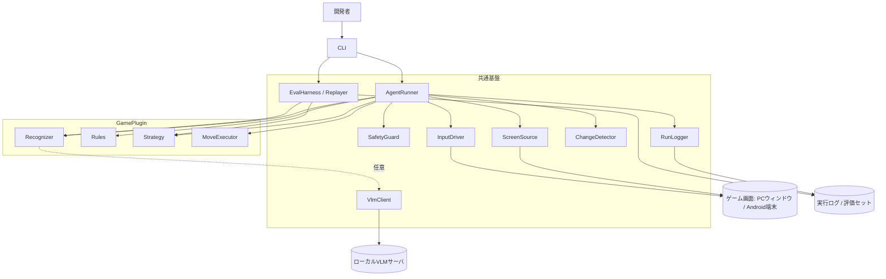
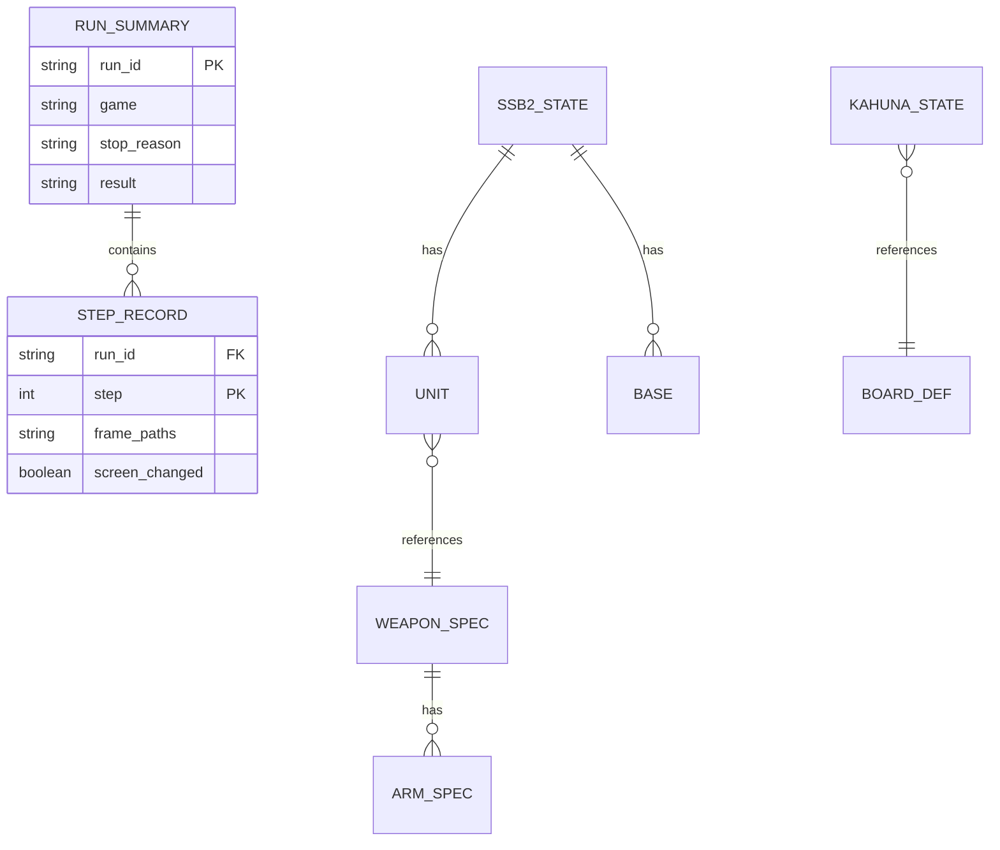
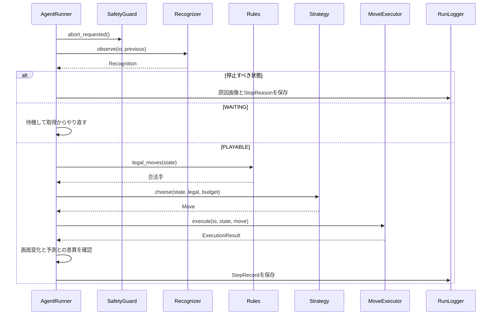
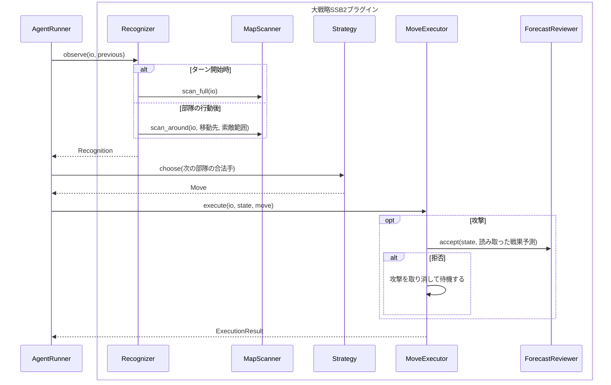
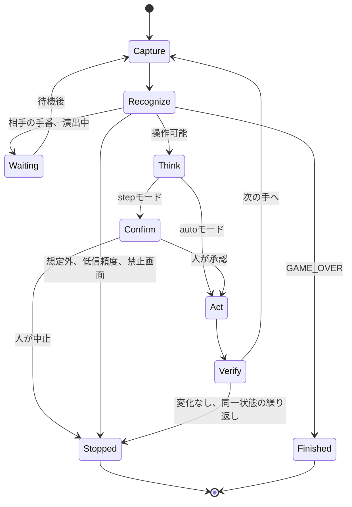

# 機能設計書 (Functional Design Document)

> **本書が単一情報源とする範囲**: データモデル、コンポーネント責務、CLI、エラーハンドリング方針。
> 要件と優先度は `01_PRODUCT-REQUIREMENTS.md`、技術スタックとレイヤー構成は `03_ARCHITECTURE-DESIGN.md`、
> ファイル配置は `04_REPOSITORY-STRUCTURE.md`、テスト戦略は `05_DEVELOPMENT-GUIDELINES.md`、用語定義は `06_GLOSSARY.md` を参照すること。
>
> **注記**: 既定値に「(仮)」を付けたものは、実機計測前の暫定値である。`docs/01` と同じく Phase 0 以降の計測で確定する。

## 要件とコンポーネントの対応

| PRD機能 | 主なコンポーネント | 分類 |
|---|---|---|
| F1 画面取得・操作 | `ScreenSource` / `InputDriver` / `GameIo` / `ChangeDetector` | 共通基盤 |
| F2 盤面認識 | `Recognizer` / `ElementReader` / `Calibration` / `MapScanner` | プラグイン(部品は共通基盤) |
| F3 ルール実装 | `Rules` | プラグイン |
| F4 思考ロジック | `Strategy` | プラグイン |
| F5 実行ループと安全装置 | `AgentRunner` / `SafetyGuard` | 共通基盤 |
| F6 ログ・失敗リプレイ | `RunLogger` / `Replayer` / `EvalHarness` | 共通基盤 |
| F7 プラグイン機構 | `GamePlugin` / `PluginRegistry` | 共通基盤 |
| F8 VLM連携 | `VlmClient` / `VlmReader` | 共通基盤 |
| F9 LoRA学習 | `DatasetBuilder` / 学習ノートブック | 共通基盤 |

## システム構成図



**設計の要点**: `Strategy` と `Rules` は画面にもVLMにも依存しない(F4)。画面に触れるのは `Recognizer` と `MoveExecutor` だけなので、ゲーム画面なしでも思考とルールを単体で検証できる。

## データモデル定義

型は Python のデータクラスと `Protocol` で示す。

### 共通モデル

```python
@dataclass(frozen=True)
class Frame:
    image: np.ndarray        # BGR、ゲーム画面のみ(ウィンドウ枠を含まない)
    width: int               # 画面取得の基準解像度
    height: int
    captured_at: datetime

@dataclass(frozen=True)
class Point:
    x: int                   # Frame座標(左上原点、ピクセル)
    y: int

@dataclass(frozen=True)
class Tap:
    at: Point

@dataclass(frozen=True)
class Drag:
    start: Point
    end: Point
    duration_ms: int

@dataclass(frozen=True)
class KeyPress:
    key: str                 # 例: "e", "enter"。Androidでは使わない

InputAction = Tap | Drag | KeyPress

class UiKind(Enum):
    PLAYABLE = "playable"    # 自分が操作できる状態
    WAITING = "waiting"      # 相手の手番や演出の待ち
    GAME_OVER = "game_over"
    FORBIDDEN = "forbidden"  # オンライン対戦など、操作してはいけない画面
    UNKNOWN = "unknown"      # 想定外の画面

@dataclass(frozen=True)
class UiState:
    kind: UiKind
    screen: str              # プラグインが定義する画面名。例: "battle_forecast"

@dataclass(frozen=True)
class Recognition(Generic[S]):
    ui: UiState
    state: S | None          # PLAYABLE以外ではNoneでよい
    confidence: float        # 0.0〜1.0。読み取った要素の最小値
    low_confidence: tuple[str, ...] = ()  # 閾値未満だった要素の名前
```

**制約**:
- 座標はすべて `Frame` 座標で扱い、ウィンドウ位置や端末の向きへの変換は `InputDriver` が担う
- `Recognition.confidence` が閾値未満のときは `state` を信用せず停止する。大戦略SSB2の索敵範囲外は「不明」という正しい読み取り結果であり、低信頼度とは区別する

### 実行ログのモデル

```python
class StopReason(Enum):
    GAME_OVER = "game_over"
    USER_ABORT = "user_abort"            # 緊急停止キー
    STEP_LIMIT = "step_limit"
    NO_SCREEN_CHANGE = "no_screen_change"
    REPEATED_STATE = "repeated_state"
    LOW_CONFIDENCE = "low_confidence"
    UNKNOWN_SCREEN = "unknown_screen"
    FORBIDDEN_SCREEN = "forbidden_screen"
    NO_LEGAL_MOVE = "no_legal_move"
    SOURCE_LOST = "source_lost"          # ウィンドウ消失、端末切断

@dataclass
class StepRecord:
    run_id: str
    step: int                # 1始まりの連番
    frame_paths: list[str]   # 1手で取得した画像。スクロールや途中確認で複数枚になる
    recognition: dict        # Recognitionをシリアライズしたもの
    legal_move_count: int
    chosen_move: dict | None
    actions: list[dict]      # 実行したInputAction
    predicted_diff: dict | None # 予測盤面と実際の盤面の差異(F3)
    screen_changed: bool
    elapsed_ms: dict[str, int] # capture / recognize / think / act の所要時間

@dataclass
class RunSummary:
    run_id: str
    game: str
    mode: str                # "step" | "auto"
    started_at: datetime
    ended_at: datetime
    stop_reason: StopReason
    result: str | None       # "win" | "lose" | "draw" | None
    steps: int
```

### Kahunaのモデル

実装は `plugins/kahuna/logic/models.py`。島・点線・プレイヤーは添字で表し、盤面の定義(島の名前、27本の点線とその画像座標)は `plugins/kahuna/data/board.json` にある。

```python
class Player(IntEnum):       # 杖コマ・カフナコマの持ち主。自分の視点では ME、相手は OPPONENT
    ME = 0
    OPPONENT = 1

@dataclass(frozen=True)
class BoardDef:              # 盤面の静的定義。ゲーム中に変わらない
    islands: tuple[str, ...]              # 12島
    lines: tuple[Line, ...]               # 点線: 結ぶ2島(a < b)、画像座標、位置を確認済みか
    lines_of: tuple[tuple[int, ...], ...] # 島ごとの、接する点線の添字

@dataclass(frozen=True)
class KahunaState:           # 自分の視点の盤面。相手の手札と山札の順序は持たない
    sticks: tuple[Player | None, ...]   # 点線ごとの杖コマの持ち主
    stones: tuple[Player | None, ...]   # 島ごとのカフナコマの持ち主(=支配している者)
    hand: tuple[int, ...]               # 自分の手札(島の添字、上限5枚。UNKNOWN_CARD は未判明)
    market: tuple[int, ...]             # 場札(島の添字、3枚)
    deck_count: int                     # 山札の残り枚数
    round: int                          # 1〜3
    scores: tuple[int, int]             # (自分, 相手)
    round3_points: tuple[int, int]      # 3ラウンド目に得た点。同点の判定に使う
    must_draw: bool                     # 相手が引かずに終えたため、必ず引く
    opponent_to_move: bool              # 予測盤面: 自分の手番が終わった
    over: bool
    winner: Player | None

# 手(1回の操作)。手番は、カードを使う/捨てる手を0回以上、最後に引く/終える手を1回で終わる
PlaceStick(card, line)       # 手札のカードの島に接する空いた点線に杖コマを置く
RemoveStick(cards, line)     # 2枚1組(その点線が結ぶ2島の名前だけ)で相手の杖コマを1本取り除く
DiscardCard(card)            # カードを伏せて捨てる。手札が5枚だと、引く前に必要
DrawMarket(card)             # 場札から引く(手番が終わる)
DrawDeck()                   # 山札の一番上を引く(手番が終わる)
PassDraw()                   # 引かずに終える(相手が次に必ず引く)
```

**制約**(出典は `docs/ideas/Kahuna_アプリ内ルール.md`):
- 島の支配は `自分の杖コマ数 * 2 > その島の点線数` で判定する。支配を得たら、その島に接する相手の杖コマはすべて取り除く。それで相手が隣の島の支配を失ったら、その島のカフナコマも取り除く
- 手札は5枚まで。1手番に使えるカードも最大5枚なので、使った枚数の上限は手札の枚数で自然に決まる
- 手番が終わるのは、引く(場札・山札)か、引かずに終えると宣言したとき
- 引かずに終えると、相手は次の手番で必ず引く(引ける札が無ければ終えられる)
- 決算は、山札と場札の最後の1枚が取られたとき。得点は1ラウンド目が1点、2ラウンド目が2点(島の数が多い方。同数なら0点)、3ラウンド目は島の数の差。3ラウンド目は、最後のカードが取られた後、各プレイヤーがもう1手番ずつ行ってから終了する
- 勝敗は、合計点 → 3ラウンド目の得点 → 盤上の杖コマの数 → 引き分けの順で決める
- **途中終了は無い**(ご指示)。杖コマが0本になっても負けず、3ラウンドを戦って決める。アプリ内の説明には「2・3ラウンド目に杖コマが0本になると負け」とあるが適用しない。`Ruleset.early_end_without_sticks` で切り替えられ、既定は無し
- 杖コマは各プレイヤー25本まで(ご確認済み)。カフナコマは10個とご確認いただいたが、**上限としては扱わない**(実機で1人が11島を支配した。島は12なので、12個なら上限は効かない)
- 相手の手札は見えないため状態に持たない。自己対戦(`simulation.py`)は両者の手札を持つ

### Hiveのモデル

実装は `plugins/hive/logic/models.py`。盤は固定せず、駒の集まりから作る。位置は軸座標 `HexCoord(q, r)` で持ち、座標ごとに駒のスタック(下から上)を置く。画面の座標は認識側で `HexCoord` に変換する(`vision/grid.py`)。

```python
class Color(IntEnum):        # 白が先手。自分の視点では ME、相手は OPPONENT ではなく色で区別する
    WHITE = 0
    BLACK = 1

class Kind(Enum):            # 基本の8種のうち、現在の実装対象は5種。拡張は後段
    QUEEN = "queen"
    ANT = "ant"
    BEETLE = "beetle"
    GRASSHOPPER = "grasshopper"
    SPIDER = "spider"

@dataclass(frozen=True)
class HexCoord:
    q: int
    r: int

@dataclass(frozen=True)
class Piece:
    color: Color
    kind: Kind               # 同じ色・種類の駒は区別しない(盤面の同一性は種類と位置で決まる)

@dataclass(frozen=True)
class HiveState:
    stacks: Mapping[HexCoord, tuple[Piece, ...]]  # 下から上。空のマスは含めない
    hand: Mapping[tuple[Color, Kind], int]        # 手持ちの残り数。(色, 種類) → 数
    to_move: Color
    turn: int                                     # 手番の通し番号。パスも1手番に数える。女王の期限の判定に使う

    def normalized(self) -> "HiveState": ...      # 最小のqとrを原点に平行移動した状態

@dataclass(frozen=True)
class Place:  kind: Kind; to: HexCoord           # 手持ちの駒を置く
@dataclass(frozen=True)
class Move:   frm: HexCoord; to: HexCoord        # 盤の一番上の駒を動かす
@dataclass(frozen=True)
class Pass:   ...                                # 動ける手が無いときだけ使う

HiveMove = Place | Move | Pass
```

- 手持ちの数は、実機の表示から目視で数えた値を初期値とする(アリ3、カブトムシ2、バッタ3、クモ2、女王1、色ごと)。**Phase 2 で、ルールの記述と照らして確定する**
- 同一性の比較は `normalized()` の結果で行う。盤の絶対位置を持つと、盤の拡大・移動で状態が変わったように見えるため
- 駒の動きの細則(ワンハイブ、滑り込み、ゲートの禁止)は `docs/ideas/Hive_アプリ内ルール.md` が正本。実装の期待値はそこから手で作る

### 大戦略SSB2のモデル

```python
@dataclass(frozen=True)
class Hex:
    col: int                 # 0〜63
    row: int                 # 0〜63

class Visibility(Enum):
    VISIBLE = "visible"
    HIDDEN = "hidden"        # 索敵範囲外。敵の有無は不明

@dataclass(frozen=True)
class Unit:
    id: str                  # 実行中のみ有効なID
    weapon: str              # WeaponSpecのキー
    faction: str             # BLUE / RED / GREEN / YELLOW
    at: Hex
    count: int               # 編成数・耐久。0で全滅
    fuel: int | None         # 敵部隊はNone
    morale: int | None       # 敵部隊はNone
    acted: bool

@dataclass(frozen=True)
class Base:
    kind: str                # 首都 / 都市 / 空軍基地 など8種
    at: Hex
    owner: str | None        # Noneは中立

@dataclass(frozen=True)
class Ssb2State:
    turn: int                # 1〜99
    me: str
    funds: int               # 軍資金
    fuel_stock: int          # 保有燃料
    industry: int            # 工業力
    terrain: Mapping[Hex, str]         # マップごとに1回読み、以後はキャッシュ
    visibility: Mapping[Hex, Visibility]
    units: tuple[Unit, ...]            # 見えている部隊のみ
    bases: tuple[Base, ...]
    selected: Unit | None

@dataclass(frozen=True)
class WeaponSpec:            # ゲーム内の兵器詳細画面から収集する静的データ
    name: str
    altitude: str            # 高空 / 低空 / 地上・海上 / 海中
    move: int
    move_cost: dict[str, int | None]   # 地形 → 移動力消費。Noneは進入不可
    search_range: int
    defense: dict[str, int]
    arms: tuple["ArmSpec", ...]
    can_capture: bool
    cost: int

@dataclass(frozen=True)
class ArmSpec:
    name: str
    range_min: int
    range_max: int
    attack: dict[str, int]   # 対航空 / 対ヘリ / 対車両 / 対歩兵 / 対艦船 / 対潜水
    ammo: int
    after_move: bool         # Falseは移動後に使えない

@dataclass(frozen=True)
class MoveUnit:
    unit_id: str
    to: Hex

@dataclass(frozen=True)
class Attack:
    unit_id: str
    arm: str
    target: Hex

@dataclass(frozen=True)
class Wait:                  # 拠点上の歩兵はこれで占領になる
    unit_id: str

@dataclass(frozen=True)
class Store:                 # 拠点への収納
    unit_id: str

@dataclass(frozen=True)
class Produce:
    weapon: str
    at: Hex

@dataclass(frozen=True)
class EndTurn:
    pass

Ssb2Move = MoveUnit | Attack | Wait | Store | Produce | EndTurn

@dataclass(frozen=True)
class BattleForecast:        # 戦果予測画面の読み取り結果
    damage_dealt: int
    damage_taken: int
```

**MVPの行動範囲**: 移動、攻撃、待機(占領を含む)、収納、生産。搭載・発進、換装、合流、解散は対象マップで必要と判明してから追加する。生産は地上部隊から始める。

**制約**:
- ルールブックに載っている値(地形防御、拠点の性能)は該当ページを出典として静的データに持つ(F3)
- `WeaponSpec` と `move_cost` はルールブックに無いため、ゲーム内の画面から収集する。収集結果はプラグインの静的データとして保存する

### ER図



## コンポーネント設計

### ScreenSource / InputDriver

**責務**:
- 画面を `Frame` として取得し、`InputAction` を実際の入力に変換する
- PCとAndroidの差をここで吸収し、プラグインに見せない(F1)

**インターフェース**:
```python
class ScreenSource(Protocol):
    def capture(self) -> Frame: ...

class InputDriver(Protocol):
    def perform(self, action: InputAction) -> None: ...
```

| 実装 | 取得 | 入力 | 注意点 |
|---|---|---|---|
| PCウィンドウ | PrintWindowでクライアント領域を取得(前面でなくてもよい) | ウィンドウ相対座標をスクリーン座標へ変換。前面化に失敗したら入力を送らない。クリックは「移動→待機→押す→待機→離す」の順 | ウィンドウの消失を `SOURCE_LOST` として検出。前面化はAltキーを挟んで再試行する |
| Android | `adb` の画面取得(端末の解像度が基準) | `adb` のtap / swipe | シリアルを設定で必須にする。SHG11では取得した画像の座標をそのまま入力に使える(Phase 0で実測)。端末ごとに座標系が違い得るので、座標系は設定で持つ |

**依存関係**: なし(プラグインから直接呼ばない)

### GameIo

**責務**: プラグインに渡す唯一の入出力の窓口。取得した画像と送った入力をすべて記録し、入力の直前に緊急停止を確認する。

```python
class GameIo(Protocol):
    def capture(self) -> Frame: ...
    def perform(self, action: InputAction) -> None: ...
```

| 実装 | 用途 |
|---|---|
| 実行用 | `ScreenSource` と `InputDriver` を呼び、画像と入力を `StepRecord` へ記録する |
| リプレイ用 | 保存した画像を順に返し、入力は記録だけして送らない |

1手の処理で何枚の画面を読み、何回操作するかはゲームによって違う。この窓口を通すことで、`AgentRunner` はその違いを知らずに済み、リプレイもゲームに依存しない。

### ChangeDetector

**責務**: 操作前後の `Frame` を比較し、画面が変わったかを返す。比較領域はプラグインが指定できる(時計やアニメーションで誤検出しないため)。

```python
class ChangeDetector(Protocol):
    def changed(self, before: Frame, after: Frame, region: Rect | None = None) -> bool: ...
```

### GamePlugin

**責務**: ゲームごとの認識・ルール・思考・操作変換をひとまとめにして提供する(F7)。

```python
class GamePlugin(Protocol[S, M]):
    name: str
    def recognizer(self) -> "Recognizer[S]": ...
    def rules(self) -> "Rules[S, M]": ...
    def strategy(self) -> "Strategy[S, M]": ...
    def executor(self) -> "MoveExecutor[S, M]": ...
    def vlm_profile(self) -> "VlmProfile | None": ...  # 任意。LoRAとプロンプトの設定
```

**依存関係**: 共通基盤の部品(`ElementReader`、`VlmClient`)のみ。共通基盤はプラグインの具象型に依存しない。

### Recognizer / ElementReader

**責務**:
- 画面を読んで `Recognition` を作る(F2)。必要な画面の枚数はプラグインが決める
- 要素ごとに読み取り手段を差し替えられる

```python
class Recognizer(Protocol[S]):
    def observe(self, io: GameIo, previous: S | None) -> Recognition[S]: ...
    def debug_overlay(self, frame: Frame, result: Recognition[S]) -> np.ndarray: ...

class ElementReader(Protocol):
    def read(self, patch: np.ndarray) -> "Reading": ...

@dataclass(frozen=True)
class Reading:
    value: str
    confidence: float
```

**読み取り手段の段階**: 要素ごとに設定で順序を決め、信頼度が閾値を超えた時点で打ち切る。

```text
テンプレートマッチング → 小型CNN / OCR → VLM
```

VLMは「読み取りの最後の手段」であり、要素単位の切り出し画像だけを渡す。

### Calibration / MapScanner

**責務**:
- `Calibration`: 画面座標と盤面座標を相互に変換する。基準点の手動指定から変換行列を求めて保存する
- `MapScanner`(大戦略SSB2): スクロールで画面を分割取得し、64×64ヘックス全体の盤面を再構成する。大戦略SSB2の `Recognizer` の内部で使い、共通基盤からは見えない

```python
class Calibration(Protocol):
    def to_screen(self, board_pos: Hashable) -> Point: ...
    def to_board(self, point: Point) -> Hashable | None: ...

class MapScanner(Protocol):
    def scan_full(self, io: GameIo) -> "ScanResult": ...
    def scan_around(self, io: GameIo, center: Hex, radius: int) -> "ScanResult": ...
```

大戦略SSB2はカメラの拡大率と角度を固定し、ヘクスの変形は射影変換で補正する。具体的なヘクスの向きとスクロール量の求め方は Phase 0 の実機確認で決める。

### Rules

**責務**: 合法手の列挙と、手を打った後の盤面の予測を行う(F3)。

```python
class Rules(Protocol[S, M]):
    def legal_moves(self, state: S) -> list[M]: ...
    def apply(self, state: S, move: M) -> S: ...       # 予測盤面を返す
    def is_terminal(self, state: S) -> bool: ...
    def outcome(self, state: S) -> str | None: ...     # 終了した盤面の勝敗(win/lose/draw)
    def diff(self, predicted: S, actual: S) -> dict: ... # 予測と実際の差異
```

大戦略SSB2の戦闘結果は計算式が不明なので、`apply` は戦闘の結果を予測せず、`diff` の比較対象から外す。

### Strategy

**責務**: 合法手から1手を選ぶ(F4)。画面にもVLMにも依存しない。

```python
class Strategy(Protocol[S, M]):
    def choose(self, state: S, legal: Sequence[M], budget: "TimeBudget") -> M: ...
```

`TimeBudget` の残り時間が尽きたら、それまでの最善手を返す。

大戦略SSB2の攻撃は、画面の戦果予測を見てから実行を判断するため、次の口を追加で持つ。読み取った結果だけを受け取るので `Strategy` は画面に依存せず、呼び出しは大戦略SSB2の `MoveExecutor` の内部に閉じる。

```python
class ForecastReviewer(Protocol[S]):
    def accept(self, state: S, forecast: BattleForecast) -> bool: ...
```

### MoveExecutor

**責務**: `Move` を実際の操作として実行する。ゲーム固有の画面遷移(部隊を選ぶ → 移動を選ぶ → 移動先を選ぶ、など)と、途中の画面確認の知識はここに閉じ込める。

```python
class MoveExecutor(Protocol[S, M]):
    def execute(self, io: GameIo, state: S, move: M) -> "ExecutionResult": ...
```

途中の画面が想定と違えば、それ以上の操作を送らず `ExecutionResult` で失敗を返す。

### AgentRunner / SafetyGuard

**責務**:
- `AgentRunner`: 取得 → 認識 → 思考 → 操作 → 変化確認のループを回す(F5)
- `SafetyGuard`: 緊急停止キーの監視と、停止条件の判定を担う。ループの各段階の前に確認する

```python
class AgentRunner[S, M]:
    def run(self) -> RunSummary: ...   # モード、プラグイン、GameIo、ログの書き込み先は生成時に渡す

class SafetyGuard:
    def abort_requested(self) -> bool: ...
    def check_ui(self, recognition: Recognition) -> StopReason | None: ...   # 禁止・想定外・低信頼度
    def check_progress(self, *, steps_done, repeated, unchanged, waited_sec) -> StopReason | None: ...
```

**実行ループの規則**(実装は `application/runner.py`):
- 1手の判断ごとに、緊急停止 → 上限(`STEP_LIMIT`) → 取得と認識 → 前の手の確定 → 画面の判定 → 進行の判定 → 思考 → 実行の順に進む
- 「前の手の確定」は、次の観測の最初の画像と、操作の対象にした画像を `ChangeDetector` で比べ、予測盤面との差異を `Rules.diff` で求めて、前の手の `StepRecord` を保存する。**画面を余分に取得しない**
- 画面が変わらなかった連続回数が `unchanged_limit`(既定2)に達したら `NO_SCREEN_CHANGE`。1回目は同じ手をやり直す
- 止めるときは、原因の画像と認識結果の重ね描きを `StepRecord` として保存し、操作は送らない
- `Strategy` が合法手以外を返したら、停止ではなくバグとして例外にする
- `RunSink`(ログの書き込み先)は `core` の Protocol で、`RunLogger` がそれを満たす。`application` は `infrastructure` に依存しない

**依存関係**: `ScreenSource`、`InputDriver`、`ChangeDetector`、`GamePlugin`、`RunLogger`

### RunLogger / Replayer / EvalHarness

**責務**:
- `RunLogger`: 各手の `StepRecord` と画像を保存する(F6)
- `Replayer`: 保存した画像から認識〜思考を再実行する。入力は行わない
- `EvalHarness`: 評価セットで認識の正答率を計測し、誤認識の画面を評価セットへ追加する

```python
class EvalHarness:
    def evaluate(self, game: str) -> "EvalReport": ...   # 要素種別ごとの正答率
    def add_case(self, frame_path: str, label: dict) -> None: ...
```

### VlmClient

**責務**: OpenAI互換APIでローカルVLMを呼び、応答をスキーマで検証する(F8)。

```python
class VlmClient(Protocol):
    def ask(self, image: np.ndarray, prompt: str, schema: type[BaseModel],
            adapter: str | None = None) -> BaseModel: ...
```

**制約**:
- 応答がスキーマに合わなければ読み取り失敗として扱い、推測で補わない
- `VlmReader` は `ElementReader` の実装であり、選択肢を限定した分類として使う
- 想定外画面の判断も、プラグインが定義した選択肢からの分類に限る。VLMの出力をそのまま操作にしない

### DatasetBuilder

**責務**: 実行ログと自動生成した盤面画像から `(画像, 正解)` の学習データを作る(F9)。アカウント情報などの領域はマスクする。学習自体はノートブックで行う。

## ユースケース図

### 1手の実行



**フロー説明**:
1. 緊急停止の要求を確認してから画面を取得する
2. `FORBIDDEN`、`UNKNOWN`、低信頼度のいずれかなら、操作せずに停止する
3. `WAITING` なら待機時間を置いて取り直す。待機が上限を超えたら `NO_SCREEN_CHANGE` で停止する
4. `step` モードでは、選んだ手を表示して人の確認を待ってから操作する
5. 操作後の盤面が予測と違っても、それだけでは止めない。差異を記録し、次の手は読み直した盤面で判断する。遭遇戦で移動が途中で止まった場合もこの経路に入る

### 大戦略SSB2の1ターン

`AgentRunner` から見れば、上の「1手の実行」を繰り返しているだけである。大戦略SSB2に固有の処理は、次の図のとおりプラグインの内部に閉じる。



**フロー説明**:
1. 地形はマップごとに1回だけ読んでキャッシュする
2. ターン開始時に部隊・拠点・視界を全体スキャンする
3. 部隊が動いたら周辺だけ読み直す。全体の読み直しをしないことで、最大50部隊の1ターンを `docs/01` の時間基準に収める
4. 部隊の選択は次部隊のショートカットで行う
5. 全部隊の行動後に `Produce` を選び、最後に `EndTurn` を選ぶ

## 実行状態の遷移



## アルゴリズム設計

重みはすべて初期値であり、対戦結果を見て調整する。

### Kahunaの手の選択

**目的**: 手札と場札から、決算で島の支配数を上回る手を選ぶ。実装は `plugins/kahuna/logic/strategy.py`、重みは `plugins/kahuna/data/strategy.toml`。

盤面を次の式で採点する(自分から見た良さ)。

```text
score = 島の重み × (自分のカフナコマ数 - 相手のカフナコマ数)
      + 3 × (自分があと1本で支配できる島の数 - 相手の数)
      + 1 × (自分の杖コマ数 - 相手の杖コマ数)

島の重み = ラウンドごとに 10 / 14 / 20。山札と場札の残りが4枚以下なら2倍
```

呼び出しごとに「次の1手」を返す。

1. **杖コマを置く/除去する手**: 各候補を `apply_unchecked` で進めて、採点の増分からカードの代価(1枚あたり1.5。除去は2枚)を引く。最良の手の正味が0.2を超えれば、それを選ぶ。手札は1手番に1枚しか増えないので、カードを使うこと自体に代価をつけた
2. **手番を終える**: 1の手が無ければ、引く。場札のカードは「持ったとき杖コマを置いて得られる増分の最大値」で比べ、山札は12島の平均の0.8倍で見積もる
3. **手札が5枚で引けない**ときは、同じ指標が最も低いカードを捨ててから引く。引く札が無ければ、引かずに終える
4. 思考時間の上限に達したら、杖コマの候補の評価を打ち切り、引く/終えるへ進む

- 途中終了で勝つ手は+1,000,000、負ける手は-1,000,000と評価する
- 相手の応手を読む探索は入れていない(F10)。評価関数の1手選択だけで、自己対戦でランダムに勝てている(受け入れ条件は `docs/01`)

### Hiveの手の選択

**目的**: 合法手から、持ち時間内で相手の女王を囲む手を選ぶ。実装は `plugins/hive/logic/strategy.py`、重みは `plugins/hive/data/strategy.toml`。

盤面を次の式で採点する(自分の色から見た良さ)。

```text
score = 2 × (相手の女王の周囲の埋まり数 - 自分の女王の周囲の埋まり数)
      + 1 × (自分の動ける手の数 - 相手の動ける手の数)
      + 1 × (自分の女王が動ける手の数 - 相手の女王が動ける手の数)  # 女王が囲まれるほど不利
      + 勝ち +1,000,000 / 負け -1,000,000

周囲の埋まり数: 女王の隣6マスのうち、駒があるマスの数(0〜6)
```

1. 合法手を列挙する(ワンハイブ、滑り込み、ゲート、女王の期限を満たすもの)。動ける手が0なら `Pass`
2. 反復深化のアルファベータで読む。深さ1から、持ち時間が切れる直前まで深くする
3. 手の並べ替えは、前の反復で良かった手を先に読む
4. 同点の手は `random.Random` を引数で受けて選ぶ(グローバル乱数は使わない。ruffで禁止)
5. 持ち時間の上限に達したら、その時点で最も良かった手を返す

- 両方の女王が囲まれた局面の扱い、パスの表示は**未確認**(`RESULT.md`)。実装は既定値(パスは動ける手が無いときだけ、同時囲みは引き分け扱いで停止)とし、画面で確かめて差し替える
- 自己対戦(`simulation.py`)で、不正な手が出ないことを確かめる

### Hiveの認識

実装は `plugins/hive/vision/`(`grid.py`、`pieces.py`、`recognizer.py`)。取得画像 1080x2432 を基準にする。テンプレートは使わない。駒の種類は絵の色で決まり、側は地の色で決まるため。

1. **マスの検出**: 白系の地(彩度が低く明るい)と黒系の地(非常に暗い)を、それぞれ連結成分で数える。隣り合うマスは、3画素の侵食で切り離す。面積が範囲内の成分を1マスとし、その中心を求める。絵で空いた穴は、厚みのある穴だけ埋める(マスどうしの細い隙間は埋めない)。手持ちの列は盤の範囲(上端 360、下端 2110)の外として除く
2. **軸座標**: 左上のマスを (0,0) とする。マスの半径 R は 77.3画素(実画面の最小二乗から求めた値)。まず公称の間隔(横 1.5R、縦 √3R)で整数の位置を決め、次に最小二乗で間隔を合わせ直す。合わせ直した後のずれが 5画素を超える、または位置が重なれば読まない(`grid_mismatch`)。拡大の違う表示(チュートリアルなど)は、ここで止まる
3. **種類**: マスの中心の絵の色(彩度と明度が高い画素)の中央値の、色相と明度を基準色と比べる。橙(明)=女王、茶=クモ、青=アリ、緑=バッタ、紫=カブトムシ。確信度が閾値(0.5)未満なら読まない(`kind@q,r`)
4. **隠れた駒**: 駒で覆われていない地の画素が閾値(2000画素)を超えると、下に隠れた駒があるとみなして止める(`hidden_piece`)。下の駒は画面からは種類が読めないため、読まずに止める
5. **採用**: 直前の状態(`previous`)と、読んだ盤面の一番上の駒の配置が一致すれば、そのまま採用する。一致しなければ、`previous` の合法手を1手打った結果と照合し、一致する手があれば採用する。どれにも一致しなければ UNKNOWN(`no_matching_move`)で止まる
6. **手持ち**: 画像からは読まない。採用した状態の手持ちを使う。`previous` が無い(最初の観測)のときは UNKNOWN(`no_previous_state`)で止まる
7. **画面の状態**: 盤が読めない、または照合できない → UNKNOWN。採用した状態が囲みで終わっている → GAME_OVER。手番が自分 → PLAYABLE、相手 → WAITING

既知の限界: メニュー、説明、選択の表示が盤に重なると 4 で止まる(安全側)。盤の拡大・移動で格子の間隔が変わると 2 で止まる。手番の表示(「Black's turn」など)は読んでいない。手番は照合した手から決める。

### 大戦略SSB2の1部隊の判断

**目的**: ターン全体の組み合わせを探索せず、1部隊ずつ行動を決める。

#### ステップ1: 移動範囲の計算

`WeaponSpec.move_cost` を重みとする最短経路探索で到達可能ヘックスを求める。見えている敵の支配エリアは通過不可として扱う。

#### ステップ2: 行動候補の採点

```text
行動の採点(大きいほど良い)
  占領      : 拠点の価値 + 首都なら大きな加点
  攻撃      : 与ダメージ見積 - 被ダメージ見積 + 地形防御の補正
  前進      : 目標(敵首都、最寄りの未占領拠点)への距離の短縮
  後退・収納: 耐久や燃料が少ないときに加点
```

ダメージ見積は `WeaponSpec` の攻撃力と防御力の差から求める粗い値で、候補の絞り込みにだけ使う。実行するかは `ForecastReviewer` が画面の戦果予測で決める。

#### ステップ3: 行動順

1. 占領が可能な歩兵
2. 攻撃が可能な部隊(与ダメージ見積の大きい順)
3. その他の部隊(目標に近い順)

#### ステップ4: 生産

資金の範囲で、歩兵の数と前線の不足を見て決める。部隊数の上限50に達していれば生産しない。

#### 見えない敵の扱い

敵の位置は見えている範囲だけで判断する。見えない敵は状態に含めず、`Visibility.HIDDEN` のヘックスは前進の採点を少し下げる。予定外の遭遇戦は再認識で吸収する。

## CLI設計

```bash
bglm run --game kahuna --mode step          # 1手ずつ確認して実行
bglm run --game ssb2 --mode auto            # 連続実行
bglm calibrate --game ssb2                  # 座標キャリブレーション
bglm capture --game kahuna                  # 画面取得と入力の疎通確認
bglm eval --game kahuna                     # 認識の正答率を計測
bglm eval add <run_id> <step>               # 誤認識の画面を評価セットへ追加
bglm replay <run_id> [--step N]             # ログから認識〜思考を再実行
```

- `--dry-run` を付けると、操作だけを行わずにループを回す
- 実行中は1行ごとに `手番 / 画面名 / 信頼度 / 選択手 / 所要時間` を表示する
- 停止時は `StopReason`、対象の画像パス、再現用の `bglm replay` コマンドを表示する

## データ保存形式

配置場所は `docs/04` を参照。

```text
<実行ログのルート>/<run_id>/
├── run.json                  # RunSummary
└── steps/
    └── 000001/
        ├── frame_01.png      # 取得した画像。1手に複数枚あり得る
        ├── overlay.png       # 認識結果の重ね描き
        └── step.json         # StepRecord

<評価セットのルート>/<game>/
├── <case_id>.png
└── <case_id>.json            # 正解ラベル
```

`step.json` の例:

```json
{
  "run_id": "20261030-190000-kahuna",
  "step": 12,
  "frame_paths": ["steps/000012/frame_01.png"],
  "recognition": {"ui": {"kind": "playable", "screen": "my_turn"}, "confidence": 0.97},
  "legal_move_count": 8,
  "chosen_move": {"type": "PlaceStick", "card": "Aloha", "line": 14},
  "actions": [{"type": "Tap", "at": {"x": 512, "y": 1880}}],
  "predicted_diff": null,
  "screen_changed": true,
  "elapsed_ms": {"capture": 420, "recognize": 310, "think": 40, "act": 900}
}
```

`card` の値は説明用の例である。実際の島名はアプリの表示に合わせる。

## 既定値

| 設定 | 既定値 | 根拠 |
|---|---|---|
| 認識の信頼度の閾値 | 0.8(仮) | 評価セットの計測で調整 |
| ステップ上限 | Kahuna 1000、大戦略SSB2 15000(仮) | 大戦略SSB2は99ターン×50部隊×3操作程度を上限の目安にした |
| 同一状態の繰り返し上限 | 3回(仮) | 同じ手の空振りを早く止めるため |
| 待機の上限 | 300秒(仮) | 相手の手番の所要時間を計測して調整 |
| 待機中の取り直しの間隔 | 2秒(仮) | 相手の手番の演出の長さを計測して調整 |
| 画面が変わらない回数の上限 | 2回 | 1回だけやり直し、それでも変わらなければ停止する(エラーハンドリングの方針) |
| 緊急停止キー | F12 | 設定で変えられる。ゲーム側のキー割り当てと衝突したら変える |
| 思考時間の上限 | `docs/01` の非機能要件に従う | `docs/01` が正本 |

値の変更時は `docs/05` のパラメータ境界値の方針に従う。

## パフォーマンス最適化

- **再認識の範囲を絞る**: 大戦略SSB2は地形をキャッシュし、部隊の行動後は周辺だけ読み直す
- **軽い手段を先に使う**: 信頼度が十分なら重い読み取り手段を呼ばない
- **ゲーム側の演出を切る**: 大戦略SSB2の戦闘シーンと移動演出はオプションで省略する
- **VLMは切り出し画像だけ**: 画面全体を送らないことで、処理時間とメモリ使用量を抑える

## セキュリティ考慮事項

- **外部送信の防止**: VLMの接続先はローカルのみ許可する。別ホストの指定は既定で拒否する
- **個人情報**: ログと評価セットはGitの管理外に置く。学習データ化の際に `DatasetBuilder` がマスクする
- **対象外の操作**: `FORBIDDEN` 画面では入力を送らない
- **緊急停止**: キー監視はループと別スレッドで行い、ループが処理中でも検知する

## エラーハンドリング

**基本方針**: 自動プレイ中に判断できないことが起きたら、推測で操作せず止める。再開はセーブからの手動で行う。

| エラー種別 | 処理 | ユーザーへの表示 |
|---|---|---|
| 緊急停止キー | 入力を止めて終了する | 「緊急停止しました」 |
| 低信頼度 | 操作せず停止。対象画像と要素名を保存する | 「認識の信頼度が不足しています: <要素名>」 |
| 想定外の画面 | 操作せず停止。VLM連携が有効なら分類を試み、結果をログに残す | 「想定外の画面です: <画像パス>」 |
| 禁止画面 | 直ちに停止する | 「対象外の画面のため停止しました」 |
| 画面変化なし | 1回だけ操作をやり直し、変わらなければ停止する | 「操作が反映されませんでした」 |
| 同一状態の繰り返し | 上限で停止する | 「同じ状態が繰り返されています」 |
| 合法手なし | 手番を終える操作が無ければ停止する | 「合法手がありません」 |
| 予測との差異 | 停止せず記録し、読み直した盤面で続ける | ログのみ |
| ウィンドウ消失、端末切断 | 停止する。端末の自動再接続はしない | 「画面を取得できません: <対象>」 |
| VLMサーバ不通、応答不正 | その読み取り手段を失敗扱いにする。他に手段が無ければ低信頼度として停止する | 「VLMを利用できません」 |
| 設定不正 | 起動前に検証して終了する | 「設定が不正です: <項目>」 |

## テスト戦略

`docs/05_DEVELOPMENT-GUIDELINES.md` の「テスト戦略」を単一情報源とする(種別・配置・カバレッジ目標・書き方)。
