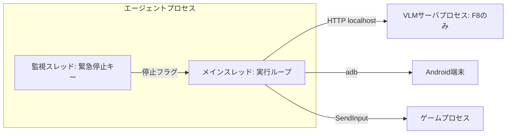
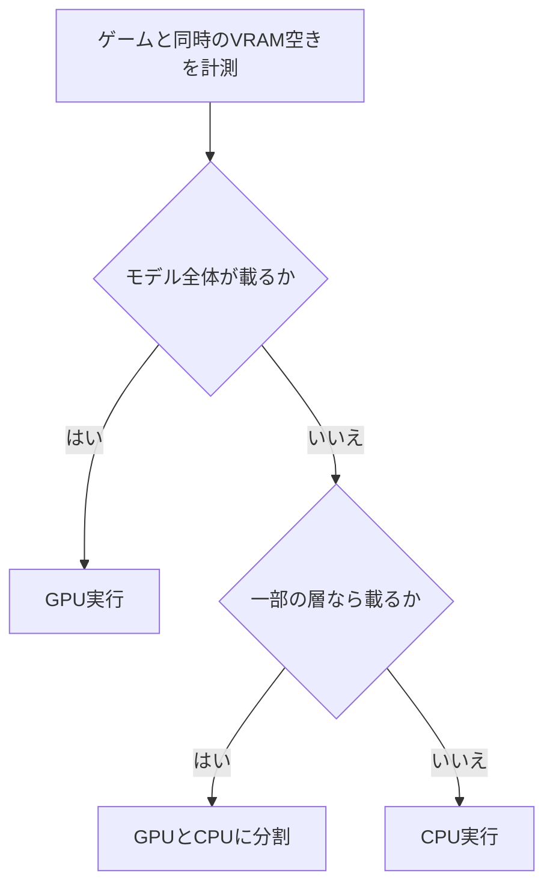

# 技術仕様書 (Architecture Design Document)

> **本書が単一情報源とする範囲**: 実行環境、技術スタックと選定理由、レイヤー構成、資源の配分、非機能要件の実現方式と測定方法、スケーラビリティ。
> 満たすべき基準値(KPIと非機能の目標値)は `01_PRODUCT-REQUIREMENTS.md`、データモデルとコンポーネントは `02_FUNCTIONAL-DESIGN.md`、ファイル配置は `04_REPOSITORY-STRUCTURE.md`、テスト戦略とコマンドは `05_DEVELOPMENT-GUIDELINES.md` を参照すること。

## 実行環境(開発機＝実行機)

| 項目 | 内容 |
|---|---|
| OS | Windows 11 Home |
| CPU | Intel Core i7-10700(物理8コア・16スレッド) |
| GPU | NVIDIA GeForce GTX 1650(VRAM 4GB) |
| メモリ | 16GB |
| 実機 | SHARP AQUOS sense8 SHG11(Android 16、1080×2432) |
| adb | `J:\Dev\AndroidStudio\platform-tools\adb.exe`(PATHに登録済み) |
| uv | 導入済み |
| Ollama | 導入済み。Qwen3-VL系のモデルは未導入 |

## テクノロジースタック

### 言語・ランタイム

| 技術 | バージョン | 選定理由 |
|------|-----------|----------|
| Python | 3.12 | PyTorch・OpenCV・ONNX RuntimeのWindows向けwheelが揃っている。同じPCの `BoardGameAI` と揃えられる。システムの3.14はネイティブ依存のwheelが揃わない場合がある |
| uv | 導入済みのもの | Python本体の取得、仮想環境、依存の固定(`uv.lock`)を1つで行える |

### ライブラリ(常時利用)

| 技術 | 用途 | 選定理由 |
|------|------|----------|
| NumPy | 画像と盤面の配列処理 | OpenCVとの受け渡しが無変換 |
| OpenCV(opencv-python) | テンプレートマッチング、射影変換、スクロール量の推定 | ゲーム画面は見た目が一定で、機械学習より速く確実に読める |
| pywin32 | ウィンドウ特定、PrintWindowによる画面取得、座標変換 | 他のウィンドウに隠れていてもゲームの内容を取得でき、20〜40msと速い(Phase 0で実測)。題名が完全一致するウィンドウで特定する |
| mss | 前面のウィンドウの画面取得(補助) | 前面なら取得できるが、隠れると上のウィンドウが写り、約110msと遅い。PrintWindowが使えない場合の代替 |
| pydirectinput | PCへの入力 | ゲームが受け付ける `SendInput` 系の入力を送れる。即時のクリックは無視されるため、「移動→待機→押す→待機→離す」の順に送る(Phase 0で実測) |
| pynput | 緊急停止キーの監視 | 別スレッドで全体のキー入力を監視できる |
| pydantic | 設定とVLM応答の検証 | スキーマ違反を実行前に検出できる |
| Typer | CLI | 型ヒントからコマンドを定義できる |
| rich | 実行中の表示 | ターミナルで表を出せる。GUIを作らずに済む |

Androidの取得と入力は、ライブラリを使わず `adb` コマンドを `subprocess` で呼ぶ。依存を増やさず、シリアル指定を確実に行うため。

### ライブラリ(必要になった時点で追加)

| 技術 | 用途 | 追加の条件 |
|------|------|----------|
| ONNX Runtime(CPU版) | 小型CNNの推論 | テンプレートマッチングで読めない要素が出たとき。CPUで動くのでVRAMを使わない |
| PyTorch | 小型CNNの学習 | 同上。GTX 1650で学習し、ONNXへ書き出す |
| RapidOCR(onnxruntime) | 文字と数字の読み取り | 数字テンプレートで足りないとき |
| openai(Python SDK) | OpenAI互換APIの呼び出し | F8の着手時 |

バージョンは導入時の最新安定版を `uv.lock` で固定する。

### VLM実行基盤(F8)

| 技術 | 用途 | 選定理由 |
|------|------|----------|
| Ollama | 既定の推論サーバ | 導入済みで、OpenAI互換APIを持つ |
| llama.cpp(llama-server) | 代替の推論サーバ | GPUへ載せる層数とLoRAの指定を細かく制御できる |

候補モデルは `docs/01` の前提に従う。候補モデルのGGUFが利用できるか、LoRAとの組み合わせが動くかは F8 の着手時に確認する。

### 学習環境(F9、必要時のみ)

| 技術 | 用途 | 選定理由 |
|------|------|----------|
| Kaggle Notebook | LoRA学習の第一候補 | CLIで実行を起動して監視できる |
| Google Colab | Kaggleの枠が足りないときの代替 | 実行の開始はブラウザから手動になる |
| Unsloth または PEFT | QLoRA / LoRA学習 | 小型モデルのファインチューニングで実績がある |

クラウド連携の手順は `MathSolver` の `ml-pipeline/cloud` を参考にする。ゲーム画面を含むデータは、公開されない領域にだけ置く。

### 開発ツール

| 技術 | 用途 | 選定理由 |
|------|------|----------|
| pytest / pytest-cov | テストとカバレッジ | パラメータ化テストでルールの組み合わせを網羅しやすい |
| ruff | lintとformat | 高速で設定が1か所に済む。`BoardGameAI` と同じ |
| mypy(strict) | 型検査 | `Protocol` の実装漏れを検出できる |
| import-linter | レイヤーの依存方向の検証 | 下記の依存ルールを機械的に守れる |

## アーキテクチャパターン

### レイヤー構成

```text
┌────────────────────────────────────────────┐
│ CLI                                        │ コマンドの受付と表示
├────────────────────────────────────────────┤
│ Application                                │ AgentRunner、Replayer、EvalHarness
├──────────────────────┬─────────────────────┤
│ Plugin               │ Infrastructure      │
│ (ゲームごと)          │ 画面取得、入力、VLM  │
│  ├─ logic: Rules,    │ ログ保存            │
│  │   Strategy        │                     │
│  └─ vision: 認識,    │                     │
│      MoveExecutor    │                     │
├──────────────────────┴─────────────────────┤
│ Toolkit                                    │ 認識の共通部品
├────────────────────────────────────────────┤
│ Core                                       │ データモデル、Protocol
└────────────────────────────────────────────┘
```

#### CLI
- **責務**: 引数の解析、プラグインの選択、結果の表示
- **許可**: Application の呼び出し
- **禁止**: 画面取得や入力の直接実行

#### Application
- **責務**: 実行ループ、安全装置、リプレイ、評価
- **許可**: Core の `Protocol` を通した Plugin と Infrastructure の利用
- **禁止**: 個別ゲームの知識を持つこと。Plugin の具象クラスの import

#### Plugin
- **責務**: `docs/02` の `GamePlugin` の実装
- **許可**: Core の利用。`vision` から Toolkit と `logic` のデータモデルの利用
- **禁止**: `logic` から `vision`、Toolkit、OpenCV、VLMへの依存。Plugin 間の依存

#### Infrastructure
- **責務**: 外部(ウィンドウ、adb、VLMサーバ、ファイル)とのやり取り
- **許可**: Core の利用
- **禁止**: ゲーム固有の処理

#### Toolkit
- **責務**: テンプレートマッチング、段階的な読み取りなど、複数の Plugin が使う認識の部品
- **許可**: Core の利用
- **禁止**: Plugin と Infrastructure への依存。VLMは `VlmClient` の `Protocol` を受け取って使う

#### Core
- **責務**: 共通のデータモデルと `Protocol` の定義
- **禁止**: 他のレイヤーへの依存

### この構成にした理由

- **`logic` を画面から切り離す**: 思考とルールを実機なしで大量にテストできる(F4)
- **Plugin の具象を Application から見えなくする**: ゲームを追加しても共通基盤を変更せずに済む(KPI)
- **Infrastructure を Protocol の裏に置く**: 実機が無くても、録画した画像を返す偽の `ScreenSource` で実行ループを検証できる

### プロセス構成



実行ループは単一スレッドの同期処理とする。1手ずつ順に進むので並列化の利点が小さく、再現性を優先する。

## 資源の配分

GPUメモリの制約は `docs/01` の非機能要件が正本。以下はそれを満たすための配分である。

| 処理 | 実行場所 | VRAM | 理由 |
|---|---|---|---|
| ゲーム本体(大戦略SSB2) | GPU | 約330 MiB(戦闘マップ。Phase 0で実測) | ゲーム自身が使う |
| ゲーム本体(Kahuna) | Android端末 | 0 | PCのGPUを使わない |
| テンプレートマッチング | CPU | 0 | |
| 小型CNNの推論 | CPU | 0 | ゲームとVRAMを奪い合わない |
| 思考ロジック | CPU | 0 | `docs/01` の要件 |
| VLM(Qwen3-VL-2B 4bit) | GPU 80% / CPU 20% | 約1.1GB(ゲームと同時のピークは全体で3.5GB。Phase 0で実測) | 下記の切り替え手順に従う。4Bは載らない見込み |

### VLMの配置の判断



VLMは読み取りの最後の手段であり、呼ぶ回数が少ない前提なのでCPU実行でも成立する見込みである。大戦略SSB2でVLMが必要な場面は実行の途中で発生するため、ゲームのグラフィック設定を下げてVRAMを空ける余地も残す。

## データ永続化戦略

### ストレージ方式

| データ種別 | ストレージ | フォーマット | 理由 |
|-----------|----------|-------------|------|
| 実行ログ | ファイル | JSON + PNG | 人が直接開いて原因を調べられる |
| 評価セット | ファイル | PNG + JSON | 同上。手で修正できる |
| キャリブレーション結果 | ファイル | JSON | ゲームと解像度ごとに保存する |
| ゲームの静的データ(`BoardDef`、`WeaponSpec`、地形) | ファイル | JSON | データだけ差し替えられる。出典を持てる |
| マップの地形キャッシュ | ファイル | JSON | マップごとの再スキャンを省く |
| テンプレート画像、CNNの重み | ファイル | PNG / ONNX | ゲーム画面の切り出しを含むのでGit管理しない |
| 設定 | ファイル | TOML | Python標準の `tomllib` で読める |

データベースは使わない。件数が少なく、ファイルのまま確認できる利点が大きいため。

### ログの保持

- 1手の画像は端末画面で1枚数MBの見込みで、長いゲームではログが数十GBになり得る
- 実行ログの総量が上限(既定20GB(仮))を超えたら、古くて正常終了した実行から削除する
- 停止理由が異常の実行は自動で削除しない

### バックアップ

評価セットの正解ラベルと静的データは手作業の成果なので、静的データはGitで管理する。評価セットはゲーム画面を含むためGit管理せず、手動でコピーを取る。

## パフォーマンス要件の実現

基準値は `docs/01` が正本。ここには測定方法と時間の見積もりを書く。

### 測定方法

| 指標 | 測定方法 | 測定環境 |
|---|---|---|
| 1手の所要時間 | `StepRecord.elapsed_ms` を実行ごとに集計 | 本書の実行環境、実ゲーム |
| 大戦略SSB2の1ターンの時間 | ターン内の `StepRecord` の合計 | 部隊50の局面 |
| 認識時間 | `elapsed_ms.recognize` | 同上 |
| 思考時間 | `elapsed_ms.think` | 同上 |
| GPUメモリ使用量 | `nvidia-smi` を実行中に定期取得し、最大値を記録 | ゲームとVLMの同時実行 |
| 緊急停止の反応時間 | 自動テストで押下から入力停止までを計測 | 実行ループ |

### 大戦略SSB2の時間の見積もり

未計測の見積もりであり、Phase 2 以降の実測で置き換える。

| 処理 | 1部隊あたり | 根拠 |
|---|---|---|
| 周辺の読み直し | 1秒 | 全体は読まず、周辺のヘックスだけ |
| 思考 | 1秒 | 移動範囲の探索と候補の採点 |
| 操作(選択、移動、コマンド、確認) | 6秒 | クリック4回に演出待ちを加えた値 |
| 合計 | 8秒 | |

部隊50では約7分となり、ターン開始時の全体スキャンと生産を足しても `docs/01` の基準に収まる見込みである。**操作の待ち時間が支配的**なので、ゲームの演出を切る設定が最も効く。

## セキュリティアーキテクチャ

### データ保護

- 外部へ送信するのはF9の学習データだけで、それも手動で行う
- VLMの接続先の既定は `127.0.0.1` とし、別ホストを設定すると起動時に拒否する。クラウドのLLMへ画面を送らないため
- ログと評価セットはGit管理の対象外にする
- APKとルールブックPDFはGit管理の対象外にする

### 機密情報

- 実行時に認証情報は使わない
- F9で使うKaggleやHugging Faceのトークンは環境変数で渡し、リポジトリに置かない

### 入力の安全

- `InputDriver` は対象のウィンドウが前面にあることを確認してから入力を送る。別のアプリに誤ってクリックしないため
- Androidの入力は、設定で指定したシリアルの端末にだけ送る
- 管理者権限は、入力が通らないと判明した場合にのみ使う

## スケーラビリティ設計

### データ増加への対応

| データ | 想定量 | 対策 |
|---|---|---|
| 1実行のステップ数 | 上限は `docs/02` の既定値 | ステップごとに別ファイルとして書き、メモリに溜めない |
| 実行ログ | 数十GB | 上記の保持方針で削除 |
| 評価セット | 各ゲーム数百件 | そのままファイルで管理 |

### 機能拡張性

- **ゲームの追加**: `GamePlugin` を実装し、設定に登録する。手順は `docs/05` に書く
- **認識手段の追加**: `ElementReader` を実装する
- **入力元の追加**: `ScreenSource` と `InputDriver` を実装する。例えばエミュレータ対応
- **VLMサーバの変更**: OpenAI互換APIであれば接続先の変更だけで済む
- **勢力数**: データモデルは最大4勢力に対応する。MVPの評価は2勢力で行う

## 状態管理設計

- 実行状態は `AgentRunner` が1か所で保持する。遷移は `docs/02` の「実行状態の遷移」に従う
- 盤面の状態は不変のデータクラスとして扱い、1手ごとに作り直す。`Rules.apply` の予測と実際の比較を単純にするため
- 再開はゲーム側のセーブに任せ、エージェントは実行の途中経過を持ち越さない。再起動時は画面の認識から始める
- 停止は監視スレッドが立てるフラグで伝え、`GameIo` が入力の直前にも確認する

## テスト環境

テスト種別・配置・カバレッジ目標は `docs/05` の「テスト戦略」が単一情報源である。本書固有の設定は次のとおり。

- 実機が要るテストには pytest の `device` マーカーを付け、通常の実行から除外する
- 録画済みの画像で動く偽の `ScreenSource` を用意し、実機なしで実行ループを検証する

## 技術的制約

### 環境要件
- **OS**: Windows 11(PCゲームの入力にWin32 APIを使う)
- **メモリ**: 16GB。VLMをCPUで動かす場合はモデルサイズ分の空きが必要
- **ディスク**: 実行ログの上限 + 数GB
- **外部依存**: adb(Android)、Windows版の大戦略SSB2、VLMサーバ(F8のみ)

### 動作上の制約
- 大戦略SSB2の実行中はゲームウィンドウを前面に置き、PCの他の操作を行わない
- 解像度、ウィンドウサイズ、カメラの拡大率と角度を変えるとキャリブレーションのやり直しになる
- Androidは USBデバッグの有効化が必要。`adb input` の座標系は端末で異なる。SHG11(Android 16)では取得した画像の座標(回転後)をそのまま渡せることを実測した(Phase 0)。端末を変えたら最初の1タップで判定する
- Kahunaは Unity IL2CPP 製で、ソースからのルール確認はしない。挙動は画面の観察で確認する

### クラウドGPUの制約
- 無料枠の内容は変わるため、F9の着手時に確認する
- Colabは実行の開始をプログラムから行えない

## 依存関係管理

| ライブラリ | 用途 | バージョン管理方針 |
|-----------|------|-------------------|
| すべて | 全体 | `uv.lock` で完全に固定する |
| opencv-python、numpy | 認識 | 更新時は評価セットの結果を比較する |
| onnxruntime、torch | CNN | 必要になった時点で追加する |
| 開発ツール | 品質確認 | 依存グループ `dev` に分ける |
