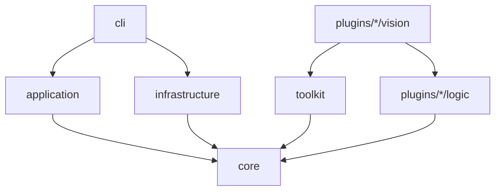

# リポジトリ構造定義書 (Repository Structure Document)

> **本書が単一情報源とする範囲**: ファイル配置、命名規則、依存ルール、実装ファイル一覧。
> レイヤーの責務と理由は `03_ARCHITECTURE-DESIGN.md`、各コンポーネントの内容は `02_FUNCTIONAL-DESIGN.md` を参照すること。

パッケージ名は `bglm` とする。実装前の計画であり、`src/` 以下は実装時に本書へ合わせて作成する。

## プロジェクト構造

```text
BoardGameLLM/
├── src/bglm/               # ソースコード
│   ├── cli/                # コマンド
│   ├── application/        # 実行ループ、リプレイ、評価
│   ├── infrastructure/     # 画面取得、入力、VLM、ログ保存
│   ├── toolkit/            # 認識の共通部品
│   ├── core/               # データモデル、Protocol
│   └── plugins/            # ゲームごとのプラグイン
│       ├── kahuna/
│       ├── hive/
│       └── ssb2/
├── tests/                  # テスト
│   ├── common/             # 共通基盤のテスト(ゲームを問わない)
│   └── plugins/<game>/     # ゲーム固有のテスト
├── config/                 # ゲームごとの設定、キャリブレーション結果
├── scripts/                # 開発補助スクリプト(common/ と <game>/)
├── notebooks/              # クラウドGPUでの学習(F9)
├── docs/                   # プロジェクトドキュメント
├── .steering/              # 作業単位のドキュメント
├── assets/                 # テンプレート画像(Git管理外)
├── models/                 # CNNの重み、LoRA(Git管理外)
├── datasets/               # 評価セット、学習データ、撮影素材(Git管理外)
├── runs/                   # 実行ログ(Git管理外)
├── cache/                  # マップの地形キャッシュ(Git管理外)
├── apk/                    # 取得したAPK(Git管理外)
└── pyproject.toml
```

## ディレクトリ詳細

### src/bglm/ (ソースコード)

#### cli/

**役割**: `docs/02` の「CLI設計」のコマンドを実装する。

**依存関係**:
- 依存可能: `application`、`infrastructure`(組み立てのみ)、`core`
- 依存禁止: `plugins` の内部モジュール

#### application/

**役割**: ゲームに依存しない実行の制御。

**依存関係**:
- 依存可能: `core`
- 依存禁止: `plugins`、`infrastructure` の具象クラス

具象クラスは `cli` が組み立てて渡す。プラグインは `registry.py` が設定のゲーム名から動的に読み込む。

#### infrastructure/

**役割**: 外部とのやり取り。

**依存関係**:
- 依存可能: `core`
- 依存禁止: `application`、`plugins`、`cli`

#### toolkit/

**役割**: 複数のプラグインが使う認識の部品。

**依存関係**:
- 依存可能: `core`
- 依存禁止: `application`、`infrastructure`、`plugins`、`cli`

#### core/

**役割**: 共通のデータモデルと `Protocol`。標準ライブラリ、NumPy、pydanticのみ使う。

**依存関係**:
- 依存禁止: `bglm` の他のすべてのパッケージ

#### plugins/

**役割**: ゲームごとの `GamePlugin`。ゲームごとに次の構成とする。

```text
plugins/<game>/
├── __init__.py             # GamePluginの実装と公開
├── logic/                  # ルールと思考。画面に依存しない
├── vision/                 # 認識と操作変換
└── data/                   # 静的データ(JSON)
```

**依存関係**:
- `logic` の依存可能: `core`、同じプラグインの `logic`
- `logic` の依存禁止: `vision`、`toolkit`、OpenCV、`infrastructure`
- `vision` の依存可能: `core`、`toolkit`、同じプラグインの `logic`
- 依存禁止: 他のプラグイン

### tests/ (テスト)

共通基盤のテストとゲーム固有のテストを、最上位で分ける。どちらも中は同じ種別(`unit/`、`integration/`、`device/`)で分ける。

```text
tests/
├── common/                     # 共通基盤。ゲームのコードを import しない
│   ├── unit/                   # src/bglm/ の core・application・infrastructure・toolkit・cli と同じ構造
│   │                           # test_import_contracts.py(依存方向)、test_package.py もここ
│   ├── integration/            # 偽のゲームでの結合(Runner + Logger など)
│   └── support/                # 偽のゲームと共有の組み立て補助(fake_game.py)
└── plugins/
    └── <game>/                 # ゲーム固有。他のゲームのテストを import しない
        ├── unit/{logic,vision}/    # src/bglm/plugins/<game>/ と同じ構造
        ├── integration/            # そのゲームの録画や実プラグインを通す結合
        ├── device/                 # 実機やゲームが必要なテスト(-m device で実行)
        ├── support/                # そのゲームの盤面組み立て補助(helpers.py)
        └── fixtures/               # 自作の盤面データなど、Git管理してよいもの
```

| 種別 | 内容 |
|---|---|
| `unit/` | 単一モジュールのテスト |
| `integration/` | 複数モジュールの結合。実機なし |
| `device/` | 実機やゲームが必要なテスト。`device` マーカーで通常の実行から外す |
| `support/` | 複数のテストが共有する偽物と組み立て補助。共通は `tests/common/support/`、ゲーム固有は `tests/plugins/<game>/support/` |

import は `tests.common.support.fake_game`、`tests.plugins.<game>.support.helpers` の形で書く。

### docs/ (ドキュメント)

| ファイル | 内容 |
|---|---|
| `01_PRODUCT-REQUIREMENTS.md` | プロダクト要求定義書 |
| `02_FUNCTIONAL-DESIGN.md` | 機能設計書 |
| `03_ARCHITECTURE-DESIGN.md` | 技術仕様書 |
| `04_REPOSITORY-STRUCTURE.md` | リポジトリ構造定義書(本書) |
| `05_DEVELOPMENT-GUIDELINES.md` | 開発ガイドライン |
| `06_GLOSSARY.md` | 用語集 |
| `ideas/` | 検討メモ、ルールブックPDF(PDFはGit管理外) |

### config/ (設定)

```text
config/
├── kahuna.toml             # 接続先、閾値、読み取り手段の順序
├── hive.toml
├── ssb2.toml
└── calibration/
    ├── kahuna-1080x2432.json
    ├── hive-1080x2432.json
    └── ssb2-<解像度>.json
```

### scripts/ (スクリプト)

```text
scripts/
├── check.ps1               # lint、型検査、依存方向、テストを一括実行する
├── common/                 # ゲームを問わない道具
│   ├── adb_capture.py      # 端末の画面取得・タップ・速度測定
│   ├── win_capture.py      # PCウィンドウの取得・クリック・キー
│   ├── vram_log.py         # GPUメモリ使用量の記録
│   ├── observe.py          # 入力を送らず画面を保存する(--game で指定)
│   ├── record_session.py   # 人が遊んでいる間の画面の記録(素材集め)
│   └── step_once.py        # 実機で1手だけ、認識 → 思考 → 操作(--game で指定。GamePlugin の形のゲーム)
└── <game>/                 # そのゲーム専用(kahuna: 認識素材の収集・テンプレート作成など)
    └── step_hooks.py       # step_once へのゲーム固有の差し込み(任意。kahuna: 引く操作が残っている印、hive: 初期状態から読む)
```

実行は `uv run python -m scripts.<common|game>.<名前>`。新しい道具は、ゲーム名が要るなら `<game>/`、`--game` で切り替えられるなら `common/` に置く。

### notebooks/ (学習、F9)

| ファイル | 役割 |
|---|---|
| `train_lora.ipynb` | KaggleとColabで共通に使う学習ノートブック |

## 実装ファイル一覧

本書が正本である。実装時に増減があれば本表を更新する。

### 共通基盤

| ファイル(`src/bglm/` 以下) | 主なコンポーネント |
|---|---|
| `cli/main.py` | CLIの入口 |
| `application/runner.py` | `AgentRunner` |
| `application/safety.py` | `SafetyGuard` |
| `application/game_io.py` | `GameIo` の実行用とリプレイ用 |
| `application/serialization.py` | 手・盤面・認識結果をログに保存する形へ変換する |
| `application/replay.py` | `Replayer` |
| `application/evaluation.py` | `EvalHarness` |
| `application/registry.py` | `PluginRegistry` |
| `application/dataset.py` | `DatasetBuilder` |
| `core/models.py` | `Frame`、`InputAction`、`Recognition`、`StepRecord` など |
| `core/protocols.py` | `ScreenSource`、`InputDriver`、`GamePlugin` など |
| `core/errors.py` | 例外の定義 |
| `core/config.py` | 設定のモデル |
| `infrastructure/pc_window.py` | PC用の `ScreenSource` と `InputDriver` |
| `infrastructure/adb_device.py` | Android用の `ScreenSource` と `InputDriver` |
| `infrastructure/change_detector.py` | `ChangeDetector` |
| `infrastructure/run_logger.py` | `RunLogger` |
| `infrastructure/vlm_client.py` | `VlmClient` |
| `toolkit/calibration.py` | `Calibration` の共通処理 |
| `toolkit/template_reader.py` | テンプレートマッチングの `ElementReader` |
| `toolkit/ocr_reader.py` | OCRの `ElementReader` |
| `toolkit/cnn_reader.py` | 小型CNNの `ElementReader` |
| `toolkit/vlm_reader.py` | VLMの `ElementReader` |
| `toolkit/reader_chain.py` | 読み取り手段の段階的な実行 |
| `toolkit/images.py` | 画像ファイルの読み込み(日本語のパスでも読める)、グレースケール、領域 `(x0, y0, x1, y1)` の切り出し |
| `toolkit/matching.py` | テンプレートとの正規化相関(最大値と位置、山の列挙) |
| `toolkit/components.py` | 2 値画像の連結成分(箱・面積・重心) |
| `toolkit/waiting.py` | 「取得して確かめる。だめなら待って取り直す」(`poll`) |
| `toolkit/screen.py` | 取得画像の大きさ(SHG11 の横向き 2432x1080)と、その確認 |

### プラグイン

| ファイル(`src/bglm/plugins/` 以下) | 主なコンポーネント |
|---|---|
| `kahuna/__init__.py` | Kahunaの `GamePlugin` |
| `kahuna/logic/models.py` | `BoardDef`、`KahunaState`、`KahunaMove` |
| `kahuna/logic/rules.py` | Kahunaの `Rules` |
| `kahuna/logic/strategy.py` | Kahunaの `Strategy` |
| `kahuna/logic/simulation.py` | 両者の手札を持つ自己対戦(logic だけで1ゲームを完走する) |
| `kahuna/vision/recognizer.py` | Kahunaの `Recognizer` |
| `kahuna/vision/executor.py` | Kahunaの `MoveExecutor` |
| `kahuna/data/board.json` | 島と点線の定義 |
| `kahuna/data/strategy.toml` | 評価関数の重み |
| `hive/__init__.py` | Hiveの `GamePlugin`(`create_plugin`)。組み立てと公開だけ |
| `hive/logic/models.py` | `HexCoord`、`Color`、`Kind`、`Piece`、`HiveState`、`HiveMove` |
| `hive/logic/rules.py` | Hiveの `Rules`(配置、移動、ワンハイブ、滑り込み、勝敗、パス) |
| `hive/logic/strategy.py` | Hiveの `Strategy`(反復深化のアルファベータ) |
| `hive/logic/simulation.py` | 両者の手札を持つ自己対戦(logic だけで1ゲームを完走する) |
| `hive/vision/recognizer.py` | Hiveの `Recognizer`(盤を読み、直前の状態と合法手1手で照合する) |
| `hive/vision/grid.py` | マスの検出、画面座標 ↔ 軸座標の相互変換 |
| `hive/vision/pieces.py` | 絵の色から駒の種類を判定する(テンプレートは使わない) |
| `hive/vision/screens.py` | 画面種別の判定(盤を読んだ結果から、盤・盤なし・重なり・格子の不一致を分ける) |
| `hive/vision/stitch.py` | 左右へ寄せた複数の画面のマスを、1つの格子に継ぎ合わせる |
| `hive/vision/wide.py` | 盤が画面より広いときの読み取り(`WideBoardRecognizer`、`wide_read`)と寄せる操作(`pan_content`、`board_clipped`) |
| `hive/vision/executor.py` | Hiveの `MoveExecutor`(置く・動かす。Pass は未確認のため実行しない) |
| `hive/data/strategy.toml` | 評価関数の重み |
| `monopoly/sync.py` | 手番ごとの同期(Log・現金・所有・抵当・家を台帳へ反映し、全体盤と照合する。再同期。保存・再開) |
| `monopoly/runtime.py` | 実行ループ(`Agent`、`step`、`run`)。1 画面を判別して、判断し、操作を高々 1 つ送る。画面ごとの処理は `_HANDLERS` に集約。**`GamePlugin` の形にはまだしていない**(`.steering/20261104-monopoly-autoplay-handoff`) |
| `monopoly/logic/board.py`、`catalogue.py`、`cards.py` | 盤の 40 マス、28 の土地の定義(価格・賃料・建設費)、Chance / Community Chest。値は実機とルールブックで確かめた |
| `monopoly/logic/rules.py`、`engine.py`、`simulation.py` | ルールと、自己対戦(方針の比較用)。画面に依存しない |
| `monopoly/logic/policies.py` | 方針(`ExpectedValuePolicy`: 購入・競りの上限・建設・取引の価値)。購入と競りの上限は、同じ `deed_value` から出す |
| `monopoly/logic/decisions.py` | 実機の状態から、方針へ問い合わせる(`Decider`: 購入、入札、建設、取引の応答、保釈、資金調達) |
| `monopoly/logic/auction_bid.py` | 入札額(推定のすぐ上から入札、相手の現金と同額で落札、勝てないときは相手に払わせる入札) |
| `monopoly/logic/opponent_model.py` | 相手の入札の上限の推定(`BidModel`。対局中の観測から学習。観測が無い間は保守的) |
| `monopoly/logic/landing_odds.py` | 相手が次の手番で各マスに止まる確率(ダブルの振り直し、刑務所を含む)。建設の期待収益に使う |
| `monopoly/logic/reconcile.py`、`cash_check.py` | 台帳と全体盤の照合(差のある土地・色グループだけ直す)、現金の食い違いの扱い・金額の読めない競りの逆算 |
| `monopoly/logic/jail.py` | 刑務所の判断(釈放カード、保釈金、ゾロ目待ち)。基準はユーザー指示 |
| `monopoly/logic/funding.py` | 負債の資金調達の順序(揃っていない街の抵当 → 鉄道・会社 → 取引 → 家の売却) |
| `monopoly/logic/trade_advisor.py` | 取引の提案への応答(受ける・断る・対案) |
| `monopoly/logic/events.py` | Log の文型の解析(`parse_line`)。OCR の誤読(空白の欠落、`o`→`0`、`A`→`M`)を許す。読めない行は `UnknownLine` |
| `monopoly/logic/log_replay.py` | Log から位置・刑務所・GO の通過を追う。出目の行が無い移動(カード)は、「landed on」に合わせる |
| `monopoly/logic/ledger.py`、`state_update.py`、`snapshot.py` | 現金の予測(Log から)、所有・家・抵当の反映、画面の読み取りからの状態の組み立て |
| `monopoly/vision/screens.py` | 画面の種類の判別(固定位置のテンプレート照合。購入・競り・取引・建設・刑務所・負債・終了など)。盤の色の確認(端末の色補正) |
| `monopoly/vision/cash.py`、`dice.py`、`roll_reader.py` | 所持金(桁ごとのテンプレート)、ダイスの出目、誰が振ったか |
| `monopoly/vision/log_reader.py`、`dialog_reader.py`、`trade_reader.py`、`ocr_engine.py` | Log(RapidOCR)、購入・競りの文言、取引画面の双方の提供。RapidOCR のエンジンは `ocr_engine.py` で共有する |
| `monopoly/vision/board_geometry.py`、`board_scan.py` | 全体盤 1 枚の読み取り(射影変換、所有・抵当・ホテル・家の見積もり、所持金・出目と合わせた `observe`) |
| `monopoly/vision/bars.py`、`ownership.py`、`holdings.py` | 拡大盤・建設画面の所有者(土地の下の棒の色)・家・ホテル、色グループだけを開く読み取り(`read_group_houses`)、28 か所の読み直し(予備) |
| `monopoly/vision/executor.py`、`builder.py`、`property_manager.py` | 操作: Roll・End Turn・購入・入札・Forfeit・保釈・釈放カード・取引の応答 / 建設と家の売却(`builder.change_houses`。+ / − を押し、Make Changes) / 抵当・解除 |
| `monopoly/vision/navigation.py` | 盤・拡大盤・建設画面の移動の共通部品: 盤の通常の画面へ戻る(`return_to_board`)、色グループを開いて案内を消す(`open_group`)。通知の OK などの共通の座標・待ち秒 |
| `monopoly/data/screens/` | 画面判別のテンプレート |
| `monopoly/data/digits/`、`monopoly/data/yen/` | 所持金の数字(0〜9)と ₼ のテンプレート。`scripts/monopoly/build_digit_templates.py` で、ラベル付き画像から作る |
| `maquis/logic/models.py` | Maquis の手(`Place`、`Resolve`、`EndPhase`)、`MaquisState`、`Resources`、`Phase` |
| `maquis/logic/rules.py` | Maquis の `Rules`(確認済みの範囲: 配置、巡回の出現、確認済みの行動、帰還と捕縛、敗北。任務・士気は未実装) |
| `maquis/data/actions.json` | 実機で確かめた地点の行動(医者・食料品店・カフェ、任務Bの★2つ) |
| `maquis/vision/layout.py` | 画面の座標(地点の中心、資材の丸、任務の枠、ボタン、山札の画面)。盤が固定なので定数 |
| `maquis/vision/screens.py` | 画面の種類の判別(盤・確認ダイアログ・終局・山札・タイトル・不明) |
| `maquis/vision/nodes.py` | 地点と任務の枠の団員・巡回・「!」・監獄の読み取り(基準画像との相関) |
| `maquis/vision/counters.py`、`digits.py` | 資材、団員数(N/M)、フェイズ、★、任務の種類の読み取り |
| `maquis/vision/cards.py`、`deck_reader.py` | 山札の画面のカード(絵のテンプレート)と、山札を開いて捨札の先頭を読む操作 |
| `maquis/vision/board_reading.py`、`recognizer.py` | 盤1枚の読み取りと整合の確認、前の状態との照合で `MaquisState` にする |
| `maquis/data/templates/` | 認識のテンプレート(空き地の基準、数字、画面、カードの絵、任務の絵)。`scripts/maquis/build_templates.py` が記録画面から作る |
| `maquis/logic/board.py` | 地点と道、隠れ家への到達判定(`reachable_from_hideout`)、帰還不可の地点(`stranded`) |
| `maquis/logic/patrol.py` | 巡回カードの山札(残りの多重集合。橙の数字 = ①がその地点の残り枚数) |
| `maquis/data/board.json`、`patrol_cards.json` | 地点・道と巡回カード10枚(実機の画面から。出典は各ファイルの `_source`) |
| `ssb2/__init__.py` | 大戦略SSB2の `GamePlugin` |
| `ssb2/logic/models.py` | `Ssb2State`、`Ssb2Move`、`WeaponSpec` など |
| `ssb2/logic/rules.py` | 大戦略SSB2の `Rules` |
| `ssb2/logic/pathfinding.py` | 移動範囲の探索 |
| `ssb2/logic/strategy.py` | 大戦略SSB2の `Strategy` と `ForecastReviewer` |
| `ssb2/vision/recognizer.py` | 大戦略SSB2の `Recognizer` |
| `ssb2/vision/map_scanner.py` | `MapScanner` |
| `ssb2/vision/executor.py` | 大戦略SSB2の `MoveExecutor` |
| `ssb2/data/terrain.json` | 地形の定義(出典ページ付き) |
| `ssb2/data/bases.json` | 拠点の定義(出典ページ付き) |
| `ssb2/data/weapons.json` | 兵器の性能(ゲーム画面から収集) |

**対応規則**: 共通基盤 `src/bglm/<path>/<name>.py` のテストは `tests/common/unit/<path>/test_<name>.py`、プラグイン `src/bglm/plugins/<game>/<path>/<name>.py` のテストは `tests/plugins/<game>/unit/<path>/test_<name>.py` に置く。

## ファイル配置規則

### ソースファイル

| ファイル種別 | 配置先 | 命名規則 | 例 |
|---|---|---|---|
| 共通のデータモデル | `core/` | `snake_case.py` | `models.py` |
| 外部接続の実装 | `infrastructure/` | `<対象>.py` | `adb_device.py` |
| 読み取り手段 | `toolkit/` | `<手段>_reader.py` | `template_reader.py` |
| 認識・操作の共通部品(2 つ以上のゲームが使うもの) | `toolkit/` | 役割名 | `matching.py` |
| ゲームのルールと思考 | `plugins/<game>/logic/` | 役割名 | `rules.py` |
| ゲームの認識と操作 | `plugins/<game>/vision/` | 役割名 | `executor.py` |
| ゲームの静的データ | `plugins/<game>/data/` | `<種類>.json` | `weapons.json` |

### テストファイル

| テスト種別 | 配置先 | 命名規則 | 例 |
|---|---|---|---|
| ユニットテスト | `tests/common/unit/` または `tests/plugins/<game>/unit/` | `test_<対象>.py` | `test_rules.py` |
| 統合テスト | `tests/common/integration/` または `tests/plugins/<game>/integration/` | `test_<機能>.py` | `test_runner_with_logger.py` |
| 実機テスト | `tests/plugins/<game>/device/` | `test_<ゲーム>_<機能>.py` | `test_kahuna_capture.py` |

### 実行時に生成されるファイル

| データ | 配置先 |
|---|---|
| 実行ログ | `runs/<run_id>/` |
| 評価セット | `datasets/eval/<game>/` |
| 学習データ | `datasets/train/<game>/` |
| 撮影した素材、実測用の画像、集計の途中結果 | `datasets/raw/<game>/`(ゲームを問わないものは `datasets/raw/common/`) |
| 観察で保存した画面、作業用の印 | `runs/capture/`、`runs/<game>/`、`runs/scratch/` |
| テンプレート画像 | `assets/<game>/templates/` |
| CNNの重み | `models/<game>/` |
| LoRA | `models/lora/<game>/` |
| 地形キャッシュ | `cache/ssb2/<map>.json` |

## 命名規則

### ディレクトリ名

- Pythonパッケージは `snake_case`
- ゲーム名は短い小文字の識別子にする(`kahuna`、`ssb2`)。設定ファイル、CLIの `--game`、`plugins/` のフォルダ名で同じ値を使う

### ファイル名

- Pythonファイル: `snake_case.py`
- クラス: `PascalCase`
- 関数と変数: `snake_case`
- 定数: `UPPER_SNAKE_CASE`
- テスト: `test_<対象>.py`

## 依存関係のルール

### レイヤー間の依存



**禁止される依存**:
- `core` から他のパッケージへ
- `application` から `plugins` の import(動的読み込みのみ許可)
- `application` から `infrastructure` の具象クラスへ
- `logic` から `vision`、`toolkit`、OpenCV、VLMへ
- プラグイン同士

`import-linter` の設定で機械的に検証する。

### 循環依存

禁止する。共有が必要な型は `core` か、同じプラグインの `logic/models.py` に移す。

## スケーリング戦略

### ゲームの追加

1. `plugins/<game>/` をフォルダ構成どおりに作る
2. `config/<game>.toml` を追加する
3. `assets/<game>/` と `datasets/eval/<game>/` を用意する
4. `tests/plugins/<game>/{unit,integration,device,support}/` と、必要なら `scripts/<game>/` を作る
5. 本書の「実装ファイル一覧」にプラグイン分を追記する

共通基盤を変更する必要が出たら、インターフェースの不足として記録する(`docs/01` のKPIの確認対象)。

### 読み取り手段の追加

`toolkit/<手段>_reader.py` を追加し、ゲームの設定から順序を指定する。

### ファイルサイズの管理

- 1ファイル300行以下を推奨し、500行を超えたら分割する
- `ssb2/logic/rules.py` は大きくなる見込みなので、移動、戦闘、生産の単位で分割してよい。分割したら本書の一覧を更新する

## 特殊ディレクトリ

### .steering/

作業単位の計画と進捗を置く。

```text
.steering/
└── [YYYYMMDD]-[task-name]/
    ├── 01_REQUIREMENTS.md
    ├── 02_DESIGN.md
    └── 03_TASKLIST.md
```

### .claude/

Claude Code のプロジェクト設定を置く。

## 除外設定

### .gitignore

ゲームの著作物を含むもの、機械が生成するものを除外する。

| パターン | 理由 |
|---|---|
| `apk/` | ゲームの著作物 |
| `docs/ideas/*.pdf` | マニュアルの複製禁止の記載 |
| `assets/` | ゲーム画面の切り出し |
| `datasets/` | ゲーム画面 |
| `runs/` | ゲーム画面、容量が大きい |
| `models/` | 容量が大きい |
| `cache/` | 再生成できる |
| `.venv/`、`__pycache__/`、`.mypy_cache/`、`.pytest_cache/`、`.ruff_cache/`、`.coverage` | 開発環境 |

`.steering/` は作業履歴としてGit管理に含める。
