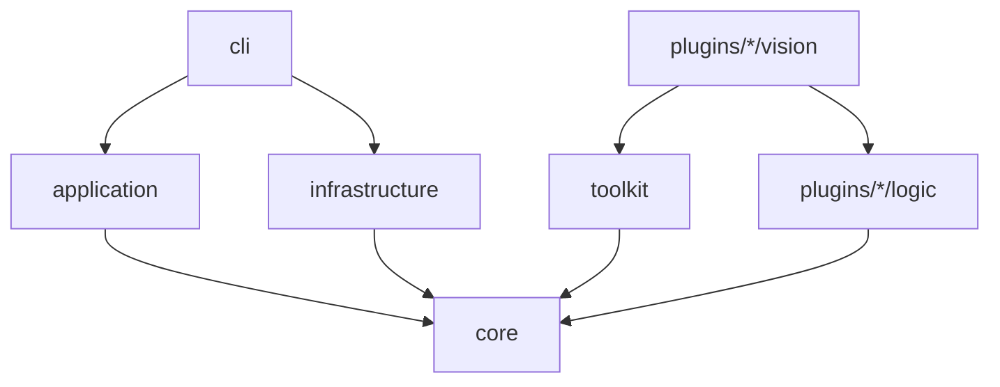

# リポジトリ構造定義書 (Repository Structure Document)

> **本書が単一情報源とする範囲**: ファイル配置、命名規則、依存ルール、実装ファイル一覧。
> レイヤーの責務と理由は `03_ARCHITECTURE-DESIGN.md`、各コンポーネントの内容は `02_FUNCTIONAL-DESIGN.md` を参照すること。

パッケージ名は `bglm` とする。実装前の計画であり、`src/` 以下は実装時に本書へ合わせて作成する。

## プロジェクト構造

```text
BoardGameLLM/
├── src/bglm/               # ソースコード
│   ├── cli/                # コマンド
│   ├── application/        # 実行ループ、リプレイ、評価
│   ├── infrastructure/     # 画面取得、入力、VLM、ログ保存
│   ├── toolkit/            # 認識の共通部品
│   ├── core/               # データモデル、Protocol
│   └── plugins/            # ゲームごとのプラグイン
│       ├── kahuna/
│       ├── hive/
│       └── ssb2/
├── tests/                  # テスト
│   ├── common/             # 共通基盤のテスト(ゲームを問わない)
│   └── plugins/<game>/     # ゲーム固有のテスト
├── config/                 # ゲームごとの設定、キャリブレーション結果
├── scripts/                # 開発補助スクリプト(common/ と <game>/)
├── notebooks/              # クラウドGPUでの学習(F9)
├── docs/                   # プロジェクトドキュメント
├── .steering/              # 作業単位のドキュメント
├── assets/                 # テンプレート画像(Git管理外)
├── models/                 # CNNの重み、LoRA(Git管理外)
├── datasets/               # 評価セット、学習データ、撮影素材(Git管理外)
├── runs/                   # 実行ログ(Git管理外)
├── cache/                  # マップの地形キャッシュ(Git管理外)
├── apk/                    # 取得したAPK(Git管理外)
└── pyproject.toml
```

## ディレクトリ詳細

### src/bglm/ (ソースコード)

#### cli/

**役割**: `docs/02` の「CLI設計」のコマンドを実装する。

**依存関係**:
- 依存可能: `application`、`infrastructure`(組み立てのみ)、`core`
- 依存禁止: `plugins` の内部モジュール

#### application/

**役割**: ゲームに依存しない実行の制御。

**依存関係**:
- 依存可能: `core`
- 依存禁止: `plugins`、`infrastructure` の具象クラス

具象クラスは `cli` が組み立てて渡す。プラグインは `registry.py` が設定のゲーム名から動的に読み込む。

#### infrastructure/

**役割**: 外部とのやり取り。

**依存関係**:
- 依存可能: `core`
- 依存禁止: `application`、`plugins`、`cli`

#### toolkit/

**役割**: 複数のプラグインが使う認識の部品。

**依存関係**:
- 依存可能: `core`
- 依存禁止: `application`、`infrastructure`、`plugins`、`cli`

#### core/

**役割**: 共通のデータモデルと `Protocol`。標準ライブラリ、NumPy、pydanticのみ使う。

**依存関係**:
- 依存禁止: `bglm` の他のすべてのパッケージ

#### plugins/

**役割**: ゲームごとの `GamePlugin`。ゲームごとに次の構成とする。

```text
plugins/<game>/
├── __init__.py             # GamePluginの実装と公開
├── logic/                  # ルールと思考。画面に依存しない
├── vision/                 # 認識と操作変換
└── data/                   # 静的データ(JSON)
```

**依存関係**:
- `logic` の依存可能: `core`、同じプラグインの `logic`
- `logic` の依存禁止: `vision`、`toolkit`、OpenCV、`infrastructure`
- `vision` の依存可能: `core`、`toolkit`、同じプラグインの `logic`
- 依存禁止: 他のプラグイン

### tests/ (テスト)

共通基盤のテストとゲーム固有のテストを、最上位で分ける。どちらも中は同じ種別(`unit/`、`integration/`、`device/`)で分ける。

```text
tests/
├── common/                     # 共通基盤。ゲームのコードを import しない
│   ├── unit/                   # src/bglm/ の core・application・infrastructure・toolkit・cli と同じ構造
│   │                           # test_import_contracts.py(依存方向)、test_package.py もここ
│   ├── integration/            # 偽のゲームでの結合(Runner + Logger など)
│   └── support/                # 偽のゲームと共有の組み立て補助(fake_game.py)
└── plugins/
    └── <game>/                 # ゲーム固有。他のゲームのテストを import しない
        ├── unit/{logic,vision}/    # src/bglm/plugins/<game>/ と同じ構造
        ├── integration/            # そのゲームの録画や実プラグインを通す結合
        ├── device/                 # 実機やゲームが必要なテスト(-m device で実行)
        ├── support/                # そのゲームの盤面組み立て補助(helpers.py)
        └── fixtures/               # 自作の盤面データなど、Git管理してよいもの
```

| 種別 | 内容 |
|---|---|
| `unit/` | 単一モジュールのテスト |
| `integration/` | 複数モジュールの結合。実機なし |
| `device/` | 実機やゲームが必要なテスト。`device` マーカーで通常の実行から外す |
| `support/` | 複数のテストが共有する偽物と組み立て補助。共通は `tests/common/support/`、ゲーム固有は `tests/plugins/<game>/support/` |

import は `tests.common.support.fake_game`、`tests.plugins.<game>.support.helpers` の形で書く。

### docs/ (ドキュメント)

| ファイル | 内容 |
|---|---|
| `01_PRODUCT-REQUIREMENTS.md` | プロダクト要求定義書 |
| `02_FUNCTIONAL-DESIGN.md` | 機能設計書 |
| `03_ARCHITECTURE-DESIGN.md` | 技術仕様書 |
| `04_REPOSITORY-STRUCTURE.md` | リポジトリ構造定義書(本書) |
| `05_DEVELOPMENT-GUIDELINES.md` | 開発ガイドライン |
| `06_GLOSSARY.md` | 用語集 |
| `ideas/` | 検討メモ、ルールブックPDF(PDFはGit管理外) |

### config/ (設定)

```text
config/
├── kahuna.toml             # 接続先、閾値、読み取り手段の順序
├── hive.toml
├── ssb2.toml
└── calibration/
    ├── kahuna-1080x2432.json
    ├── hive-1080x2432.json
    └── ssb2-<解像度>.json
```

### scripts/ (スクリプト)

```text
scripts/
├── check.ps1               # lint、型検査、依存方向、テストを一括実行する
├── common/                 # ゲームを問わない道具
│   ├── adb_capture.py      # 端末の画面取得・タップ・速度測定
│   ├── win_capture.py      # PCウィンドウの取得・クリック・キー
│   ├── vram_log.py         # GPUメモリ使用量の記録
│   └── observe.py          # 入力を送らず画面を保存する(--game で指定)
└── <game>/                 # そのゲーム専用(kahuna: 認識素材の収集・テンプレート作成・実機1手実行など)
```

実行は `uv run python -m scripts.<common|game>.<名前>`。新しい道具は、ゲーム名が要るなら `<game>/`、`--game` で切り替えられるなら `common/` に置く。

### notebooks/ (学習、F9)

| ファイル | 役割 |
|---|---|
| `train_lora.ipynb` | KaggleとColabで共通に使う学習ノートブック |

## 実装ファイル一覧

本書が正本である。実装時に増減があれば本表を更新する。

### 共通基盤

| ファイル(`src/bglm/` 以下) | 主なコンポーネント |
|---|---|
| `cli/main.py` | CLIの入口 |
| `application/runner.py` | `AgentRunner` |
| `application/safety.py` | `SafetyGuard` |
| `application/game_io.py` | `GameIo` の実行用とリプレイ用 |
| `application/serialization.py` | 手・盤面・認識結果をログに保存する形へ変換する |
| `application/replay.py` | `Replayer` |
| `application/evaluation.py` | `EvalHarness` |
| `application/registry.py` | `PluginRegistry` |
| `application/dataset.py` | `DatasetBuilder` |
| `core/models.py` | `Frame`、`InputAction`、`Recognition`、`StepRecord` など |
| `core/protocols.py` | `ScreenSource`、`InputDriver`、`GamePlugin` など |
| `core/errors.py` | 例外の定義 |
| `core/config.py` | 設定のモデル |
| `infrastructure/pc_window.py` | PC用の `ScreenSource` と `InputDriver` |
| `infrastructure/adb_device.py` | Android用の `ScreenSource` と `InputDriver` |
| `infrastructure/change_detector.py` | `ChangeDetector` |
| `infrastructure/run_logger.py` | `RunLogger` |
| `infrastructure/vlm_client.py` | `VlmClient` |
| `toolkit/calibration.py` | `Calibration` の共通処理 |
| `toolkit/template_reader.py` | テンプレートマッチングの `ElementReader` |
| `toolkit/ocr_reader.py` | OCRの `ElementReader` |
| `toolkit/cnn_reader.py` | 小型CNNの `ElementReader` |
| `toolkit/vlm_reader.py` | VLMの `ElementReader` |
| `toolkit/reader_chain.py` | 読み取り手段の段階的な実行 |

### プラグイン

| ファイル(`src/bglm/plugins/` 以下) | 主なコンポーネント |
|---|---|
| `kahuna/__init__.py` | Kahunaの `GamePlugin` |
| `kahuna/logic/models.py` | `BoardDef`、`KahunaState`、`KahunaMove` |
| `kahuna/logic/rules.py` | Kahunaの `Rules` |
| `kahuna/logic/strategy.py` | Kahunaの `Strategy` |
| `kahuna/logic/simulation.py` | 両者の手札を持つ自己対戦(logic だけで1ゲームを完走する) |
| `kahuna/vision/recognizer.py` | Kahunaの `Recognizer` |
| `kahuna/vision/executor.py` | Kahunaの `MoveExecutor` |
| `kahuna/data/board.json` | 島と点線の定義 |
| `kahuna/data/strategy.toml` | 評価関数の重み |
| `hive/__init__.py` | Hiveの `GamePlugin`(`create_plugin`)。**未作成**(フェーズ4。認識と操作がそろってから) |
| `hive/logic/models.py` | `HexCoord`、`Color`、`Kind`、`Piece`、`HiveState`、`HiveMove` |
| `hive/logic/rules.py` | Hiveの `Rules`(配置、移動、ワンハイブ、滑り込み、勝敗、パス) |
| `hive/logic/strategy.py` | Hiveの `Strategy`(反復深化のアルファベータ) |
| `hive/logic/simulation.py` | 両者の手札を持つ自己対戦(logic だけで1ゲームを完走する) |
| `hive/vision/recognizer.py` | Hiveの `Recognizer`(盤を読み、直前の状態と合法手1手で照合する) |
| `hive/vision/grid.py` | マスの検出、画面座標 ↔ 軸座標の相互変換 |
| `hive/vision/pieces.py` | 絵の色から駒の種類を判定する(テンプレートは使わない) |
| `hive/vision/screens.py` | 画面種別の判定(メニュー、説明、結果)。**未作成**(フェーズ3の残り) |
| `hive/vision/executor.py` | Hiveの `MoveExecutor`。**未作成**(フェーズ4) |
| `hive/data/strategy.toml` | 評価関数の重み |
| `ssb2/__init__.py` | 大戦略SSB2の `GamePlugin` |
| `ssb2/logic/models.py` | `Ssb2State`、`Ssb2Move`、`WeaponSpec` など |
| `ssb2/logic/rules.py` | 大戦略SSB2の `Rules` |
| `ssb2/logic/pathfinding.py` | 移動範囲の探索 |
| `ssb2/logic/strategy.py` | 大戦略SSB2の `Strategy` と `ForecastReviewer` |
| `ssb2/vision/recognizer.py` | 大戦略SSB2の `Recognizer` |
| `ssb2/vision/map_scanner.py` | `MapScanner` |
| `ssb2/vision/executor.py` | 大戦略SSB2の `MoveExecutor` |
| `ssb2/data/terrain.json` | 地形の定義(出典ページ付き) |
| `ssb2/data/bases.json` | 拠点の定義(出典ページ付き) |
| `ssb2/data/weapons.json` | 兵器の性能(ゲーム画面から収集) |

**対応規則**: 共通基盤 `src/bglm/<path>/<name>.py` のテストは `tests/common/unit/<path>/test_<name>.py`、プラグイン `src/bglm/plugins/<game>/<path>/<name>.py` のテストは `tests/plugins/<game>/unit/<path>/test_<name>.py` に置く。

## ファイル配置規則

### ソースファイル

| ファイル種別 | 配置先 | 命名規則 | 例 |
|---|---|---|---|
| 共通のデータモデル | `core/` | `snake_case.py` | `models.py` |
| 外部接続の実装 | `infrastructure/` | `<対象>.py` | `adb_device.py` |
| 読み取り手段 | `toolkit/` | `<手段>_reader.py` | `template_reader.py` |
| ゲームのルールと思考 | `plugins/<game>/logic/` | 役割名 | `rules.py` |
| ゲームの認識と操作 | `plugins/<game>/vision/` | 役割名 | `executor.py` |
| ゲームの静的データ | `plugins/<game>/data/` | `<種類>.json` | `weapons.json` |

### テストファイル

| テスト種別 | 配置先 | 命名規則 | 例 |
|---|---|---|---|
| ユニットテスト | `tests/common/unit/` または `tests/plugins/<game>/unit/` | `test_<対象>.py` | `test_rules.py` |
| 統合テスト | `tests/common/integration/` または `tests/plugins/<game>/integration/` | `test_<機能>.py` | `test_runner_with_logger.py` |
| 実機テスト | `tests/plugins/<game>/device/` | `test_<ゲーム>_<機能>.py` | `test_kahuna_capture.py` |

### 実行時に生成されるファイル

| データ | 配置先 |
|---|---|
| 実行ログ | `runs/<run_id>/` |
| 評価セット | `datasets/eval/<game>/` |
| 学習データ | `datasets/train/<game>/` |
| 撮影した素材、実測用の画像、集計の途中結果 | `datasets/raw/<game>/`(ゲームを問わないものは `datasets/raw/common/`) |
| 観察で保存した画面、作業用の印 | `runs/capture/`、`runs/<game>/`、`runs/scratch/` |
| テンプレート画像 | `assets/<game>/templates/` |
| CNNの重み | `models/<game>/` |
| LoRA | `models/lora/<game>/` |
| 地形キャッシュ | `cache/ssb2/<map>.json` |

## 命名規則

### ディレクトリ名

- Pythonパッケージは `snake_case`
- ゲーム名は短い小文字の識別子にする(`kahuna`、`ssb2`)。設定ファイル、CLIの `--game`、`plugins/` のフォルダ名で同じ値を使う

### ファイル名

- Pythonファイル: `snake_case.py`
- クラス: `PascalCase`
- 関数と変数: `snake_case`
- 定数: `UPPER_SNAKE_CASE`
- テスト: `test_<対象>.py`

## 依存関係のルール

### レイヤー間の依存



**禁止される依存**:
- `core` から他のパッケージへ
- `application` から `plugins` の import(動的読み込みのみ許可)
- `application` から `infrastructure` の具象クラスへ
- `logic` から `vision`、`toolkit`、OpenCV、VLMへ
- プラグイン同士

`import-linter` の設定で機械的に検証する。

### 循環依存

禁止する。共有が必要な型は `core` か、同じプラグインの `logic/models.py` に移す。

## スケーリング戦略

### ゲームの追加

1. `plugins/<game>/` をフォルダ構成どおりに作る
2. `config/<game>.toml` を追加する
3. `assets/<game>/` と `datasets/eval/<game>/` を用意する
4. `tests/plugins/<game>/{unit,integration,device,support}/` と、必要なら `scripts/<game>/` を作る
5. 本書の「実装ファイル一覧」にプラグイン分を追記する

共通基盤を変更する必要が出たら、インターフェースの不足として記録する(`docs/01` のKPIの確認対象)。

### 読み取り手段の追加

`toolkit/<手段>_reader.py` を追加し、ゲームの設定から順序を指定する。

### ファイルサイズの管理

- 1ファイル300行以下を推奨し、500行を超えたら分割する
- `ssb2/logic/rules.py` は大きくなる見込みなので、移動、戦闘、生産の単位で分割してよい。分割したら本書の一覧を更新する

## 特殊ディレクトリ

### .steering/

作業単位の計画と進捗を置く。

```text
.steering/
└── [YYYYMMDD]-[task-name]/
    ├── 01_REQUIREMENTS.md
    ├── 02_DESIGN.md
    └── 03_TASKLIST.md
```

### .claude/

Claude Code のプロジェクト設定を置く。

## 除外設定

### .gitignore

ゲームの著作物を含むもの、機械が生成するものを除外する。

| パターン | 理由 |
|---|---|
| `apk/` | ゲームの著作物 |
| `docs/ideas/*.pdf` | マニュアルの複製禁止の記載 |
| `assets/` | ゲーム画面の切り出し |
| `datasets/` | ゲーム画面 |
| `runs/` | ゲーム画面、容量が大きい |
| `models/` | 容量が大きい |
| `cache/` | 再生成できる |
| `.venv/`、`__pycache__/`、`.mypy_cache/`、`.pytest_cache/`、`.ruff_cache/`、`.coverage` | 開発環境 |

`.steering/` は作業履歴としてGit管理に含める。
